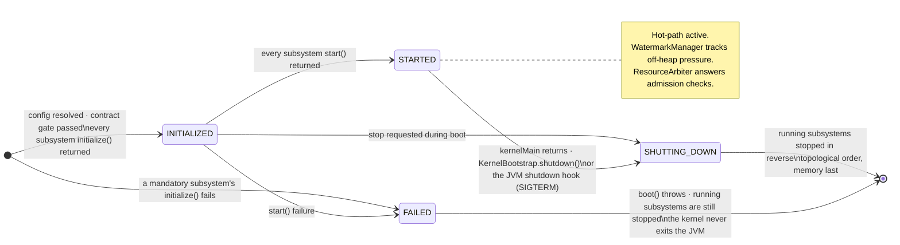
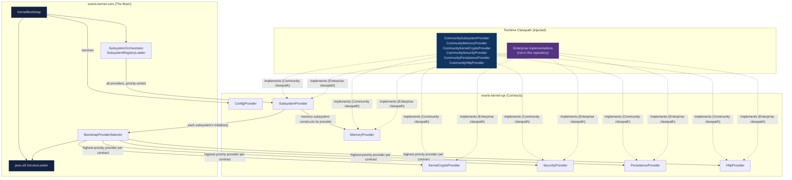
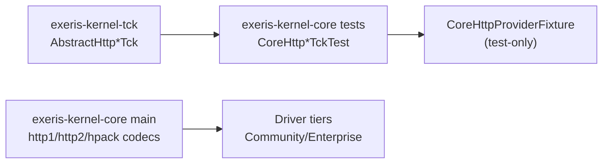

# Physical Tier: Core (The Brain)

**Module:** `exeris-kernel-core`
**Dependencies:**
- `compile`: `exeris-kernel-spi`, `org.jctools:jctools-core` (the `MpscArrayQueue` behind `AsyncTelemetrySink`)
- `test`: `exeris-kernel-tck`

## 🗺️ Bootstrap Lifecycle: State Machine

Core owns the canonical subsystem lifecycle. `KernelBootstrap.boot(Runnable)` resolves configuration and
runs the contract gate; `SubsystemOrchestrator` (both in `eu.exeris.kernel.core.bootstrap`) then initializes
and starts the subsystems. The lifecycle is irreversible — there is no `RESTART` transition; a failed node
must be replaced. `KernelHealthMonitor.KernelState` latches `INITIALIZED`, `STARTED`, `SHUTTING_DOWN`, and
`FAILED` when a mandatory subsystem fails; configuration and contract failures happen before the monitor
exists and only make `boot()` throw. The
per-subsystem state machine is in [`subsystems/bootstrap.md`](../subsystems/bootstrap.md).

## 🗺️ Driver Discovery: ServiceLoader Orchestration

Core is **driver-agnostic**. It never imports `exeris-kernel-community` or `exeris-kernel-enterprise` classes.
Concrete implementations are discovered at runtime via `ServiceLoader`, which fulfils the Open-Core SPI contract.

> **Failure behaviour:** a missing `ConfigProvider` fails `KernelBootstrap.boot()` with a
> `BootstrapException` citing `EX-CFG-0001`; the contract gate refuses with `ContractBreachException`, an
> environment the gate does not know raises `ConfigProviderException` (`EX-CFG-1002`), and a dependency
> cycle raises `SubsystemCircularDependencyException`. A subsystem whose `initialize()` or `start()` fails
> aborts the boot under the default `FAIL_FAST` policy; under `DEGRADE` only an optional subsystem outside
> `FOUNDATION` is dropped, with its dependents. Some subsystems stay inert and report
> `isRunning() == false` instead of failing — transport, http and websocket when not configured, crypto
> and security when no provider is discovered — while a mandatory subsystem whose provider is missing,
> persistence for one, fails its `initialize()`. Whatever fails, `orchestrator.shutdown()` still stops the
> subsystems already running, and the kernel never exits the JVM. See
> [`subsystems/bootstrap.md`](../subsystems/bootstrap.md).

## 🧠 Architectural Rules (L0 Enforcement)

1. **Driver Agnosticism:** Core must NEVER know if it's running on Community or Enterprise drivers. It interacts
   exclusively via `ServiceLoader` and SPI contracts.
2. **Orchestration Only:** Core makes decisions (Watermarks, Load Shedding, Backpressure), but does not execute the
   physical I/O.
3. **Structured Concurrency — mechanism depends on the distribution line (ADR-066):** all concurrent *subtasks* in Core
   must run inside a structured scope that owns their lifetime. `ThreadLocal` and raw `ExecutorService` are entirely
   BANNED, and an ad-hoc `Thread.ofVirtual().start(...)` outside a scope is not an alternative. Which scope depends on
   the track:
   - **Default line (`main`, the distributable artifact):** `eu.exeris.kernel.core.concurrent.StructuredScope`, built on
     virtual threads and `ScopedValue` (both GA), so the artifact imposes no `--enable-preview` on consumers. It is
     await-all: `join()` returns whether tasks succeeded or failed, and the caller inspects `ForkedTask.state()`.
   - **`preview` branch:** `StructuredTaskScope.open(Joiner)` with an explicit `Joiner`, and custom `Joiner`
     implementations for typed, zero-cast handover of subtask results (e.g. `LoanedBuffer`).

   `ScopedValue` context is propagated strictly into forked subtasks — but the two mechanisms achieve it differently, and
   the difference is a correctness trap rather than a detail. `StructuredTaskScope` forks **inherit** the bindings in
   effect at scope open; a plain virtual thread does **not**, and no GA API can snapshot a thread's live bindings. So
   `StructuredScope` requires the bindings to be handed in as a `ScopedValue.Carrier` and re-establishes them inside each
   task. Choosing `openWithoutBindings()` is a statement that the task bodies read no scoped value, directly or through
   any SPI they call.

   The only sanctioned exceptions are: (a) request-root / entrypoint virtual threads that own their own structured scopes,
   (b) long-lived background maintenance loops whose lifetime equals the JVM or subsystem (e.g., `MemoryMaintenanceTask`),
   and (c) PAQS per-stream virtual threads where the stream lifecycle defines the concurrency scope (`PaqsScheduler`).
   These exceptions must be explicitly documented in-code and must not reintroduce ad-hoc executors or unstructured
   concurrency.
4. **Fail-Fast Bootstrap:** The default `FAIL_FAST` policy aborts the boot — `boot()` throws, and the kernel never
   exits the JVM — when a subsystem fails to initialize or start.
5. **Synchronization (JEP 491 Amendment):** The `synchronized` keyword is **permitted exclusively** in off-heap memory
   pool internals (slab reclamation and free-list management in a driver's pool) where CAS sequences are
   susceptible to ABA problems. It is **categorically banned** around FFM `downcall` invocations or any blocking I/O —
   violations cause Virtual Thread Pinning. See ADR-007 for the full rationale.
6. **Lazy Constants (JEP 526 Semantics):** Singleton config caches and expensive one-time initialisations in Core MUST
   use a lazy, single-initialisation, same-instance mechanism (no double-checked locking, no ad-hoc `volatile` fields).
   The SPI currently models this via `Supplier<KernelSettings>` (see `ConfigProvider`); Core code must follow the same
   "compute once, then reuse without additional locking" contract to enable JVM optimisations and eliminate manual
   synchronisation in the init path.

## HTTP in Core (Current Repository State)

- HTTP wire codecs are currently implemented in `exeris-kernel-core` under `eu.exeris.kernel.core.http`.
- Implemented areas: `http1.*`, `http2.*`, `hpack.*`, `hpack.huffman.*`, plus `routing.*` (`HttpRouter`,
  path templates, stream routes), `sse.*` (`HttpStreamEngine`, `SseEventEncoder`, stream admission),
  `client.*` (`KernelWebClient`) and `jfr.*` (HTTP stream and aggregate-buffer events).
- Root reactor does not currently include a dedicated `exeris-kernel-http` module.
- Core remains responsible for delivering these codec primitives to downstream transport integrations in the current layout.

### HTTP TCK Bindings in Core (Test Scope)

- Core contains concrete test bindings for HTTP TCK suites in `src/test/java/eu/exeris/kernel/core/http/tck/*`.
- These classes validate SPI contract behavior through minimal fixtures (provider/server/client/exchange) in test scope.
- They are not production transport engines and do not implement real wire runtime responsibilities (bind/accept/connect loops).

## Native-image metadata

The module ships reachability metadata at
`META-INF/native-image/eu.exeris/exeris-kernel-core/reachability-metadata.json`.

The metadata covers:
- Foreign downcall descriptors declared in `OpenSslDowncall` and `SyscallDowncall`.
- JFR event types and their enclosing classes from `CoreJfrEventCatalogue`.
- Atomic field updates accessed via `MethodHandles.Lookup.findVarHandle`.
- Classpath resources, including `KernelVersion.RESOURCE` (`exeris-kernel.properties`) and
  the consumer manifest (`license-manifest.json`).
- Internal queue field offsets in `org.jctools.queues.MpscArrayQueue` superclasses.

The metadata is guarded by `CoreReachabilityMetadataTest`, which scans all compiled classes using the
JDK ClassFile API. It enforces that `FunctionDescriptor` construction is confined to centralized enum tables,
that downcall creation is restricted to designated loader classes, that all declaration sites match explicit
allowlist dispositions, and that the committed metadata file matches the synthesized model byte-for-byte.

The rules for producing this metadata are set by
[ADR-103](../adr/ADR-103-native-image-opt-in-build.md). On HotSpot the files are inert; they matter only
to a GraalVM 25 native-image build, verified on Linux x86-64 only; aarch64 and Windows images are
unverified. The cost is that a new
declaration site fails the guard until the committed file is regenerated: the test writes the expected
file under `target/native-image-expected/` and names the copy command.

## Stability

Core implementations bind to SPI surfaces whose maturity is declared in the
[SPI Stability Matrix](../stability-matrix.md).
