# Physical Tier: Community (The Muscle)

**Module:** `exeris-kernel-community`
**Current Repository Reality:** this module is no longer a placeholder. The repository contains a real `src/` tree,
provider implementations, bootstrap wiring, tests, and e2e assets.

**Dependencies (Current Architecture):**

- `compile`: `exeris-kernel-spi` (SPI contracts — The Wall)
- `compile`: `exeris-kernel-core` (bootstrap/runtime infrastructure shared across tiers)
- `compile`: `slf4j-api`, `jctools-core`, HikariCP (persistence pool), `nimbus-jose-jwt` (JWKS/claims),
  `jackson-databind` (JSON body encoding and decoding, event payload codec), `bcprov-jdk18on` (Argon2id), `neo4j-java-driver` (Cypher graph binding)
- `optional`: the PostgreSQL JDBC driver
- `test`: `exeris-kernel-tck`, `exeris-kernel-community-testkit`

> **Status:** `exeris-kernel-community` currently ships working Community implementations for memory, crypto,
> persistence, transport, HTTP, WebSocket, security, events, flow, graph, scheduling, blob storage,
> telemetry and diagnostics in this repository state; its `META-INF/services` registers a provider for each of
> those SPIs plus `SubsystemProvider` and `ConfigProvider`. The module also contains bootstrap integration tests,
> transport/HTTP integration tests, and TCK bindings. The load-test harness is stored in
> the separate `exeris-benchmarks` repository.
> Resource-server security path is implemented in current repository state: Community HTTP admission integrates JWT/JWKS validation and enforces explicit `401` (authentication failure) versus `403` (insufficient scope) outcomes.

> **Reality vs target-state:** parts of the original ADR-008 target architecture remain aspirational, but the module
> is operational today. The authoritative source of truth is the current source tree and tests, not the older
> placeholder narrative.

## 🗺️ Request Flow: Standard POSIX + JDBC Stack

Every incoming request traverses this pipeline. Annotations mark the **memory domain** at each stage.
`[OFF-HEAP]` = Panama `MemorySegment`; `[ON-HEAP]` = JVM Heap; `[POOL]` = slab returned to allocator.

```mermaid
flowchart TD
    NIC(["🌐 NIC / TCP Packet"])

    A["① TCP accept()\n<b>NativeTcpCarrier — NIO ServerSocketChannel, selector reactors</b>\nFile Descriptor acquired\n<i>[OS Kernel → JVM boundary]</i>"]

    B["② LoanedBuffer.allocate()\n<b>CommunityMemoryAllocator (per-shard Arena pool)</b>\nRaw bytes written to MemorySegment\nref-count = 1\n<i>[OFF-HEAP]</i>"]

    C["③ TLS unwrap\n<b>OpenSSL via Panama FFM (OffHeapTlsEngine, wrapped by CommunityTlsEngine)</b>\nSSL_read() downcall · plaintext → LoanedBuffer\nNo ByteBuffer · No heap copy\n<i>[OFF-HEAP → OFF-HEAP]</i>"]

    D{"④ PAQS Scheduler\n<b>Decision Gate</b>\nPriority queue · Watermark check\nLoad-shed if WM ceiling breached"}

    E["⑤ Virtual Thread mount\n<b>Project Loom (JEP 444)</b>\nScopedValue: KernelContext injected\n~100 bytes stack · carrier thread unmounted\n<i>[OFF-HEAP context]</i>"]

    F["⑥ Business Logic / Flow Engine\n<b>Standard Java POJOs</b>\nDeserialization · Domain objects\n<i>[ON-HEAP ⚠️ Heap Boundary]</i>"]

    G["⑦ JDBC Persistence\n<b>Standard JDBC Driver</b>\nResultSet · DTO · String materialisation\n<i>[ON-HEAP — GC may trigger here]</i>"]

    H["⑧ Response serialisation\n<b>Off-Heap write-back</b>\nLoanedBuffer filled · TLS wrap (SSL_write)\n<i>[OFF-HEAP]</i>"]

    I["⑨ TCP send() + buffer release\n<b>POSIX syscall</b>\nLoanedBuffer.close() → ref-count 0\nSegment returned to the allocator's per-shard free list\n<i>[POOL]</i>"]

    NIC --> A --> B --> C --> D
    D -->|"ADMIT"| E --> F --> G --> H --> I
    D -->|"SHED"| SHED(["🚫 Load Shed\nHTTP 503 / EX-NET-4006\nNo Virtual Thread spawned"])

    style A fill:#0f3460,color:#e0e0ff,stroke:#4a90d9
    style B fill:#0f3460,color:#e0e0ff,stroke:#2ecc71
    style C fill:#0f3460,color:#e0e0ff,stroke:#2ecc71
    style D fill:#1a1a2e,color:#ffe066,stroke:#ffe066,stroke-width:2px
    style E fill:#0f3460,color:#e0e0ff,stroke:#4a90d9
    style F fill:#3a1a1a,color:#ffb3b3,stroke:#e74c3c,stroke-width:2px
    style G fill:#3a1a1a,color:#ffb3b3,stroke:#e74c3c,stroke-width:2px
    style H fill:#0f3460,color:#e0e0ff,stroke:#2ecc71
    style I fill:#1a3a2a,color:#e0e0ff,stroke:#2ecc71
    style SHED fill:#3a1a1a,color:#ffb3b3,stroke:#e74c3c
```

> **Key Insight:** Community boots real HTTP, transport, crypto, and persistence providers today, and payload
> bytes on the network path live in off-heap `LoanedBuffer`s. Which runtime paths are zero-allocation and which
> are bounded-allocation or JDBC-bound is a per-path question answered by the TCK allocation suites, not by
> this page.

## 💪 Architectural Rules (L0 Enforcement)

1. **Community is implemented now:** `exeris-kernel-community` contains concrete provider and bootstrap code in this
   repository. Reviews and design decisions must start from the live implementation, not from the older placeholder
   assumption.
2. **Transport and TLS remain constrained by current implementation:** Community supports external HTTP/TCP
   communication today, with crypto wired into transport-backed HTTP paths. Allocation behavior still needs to be
   judged per concrete runtime path and test evidence rather than by stale module prose.
3. **The Heap Boundary (JDBC):** The heap boundary begins at the business logic layer (step ⑥).
   JDBC persistence (step ⑦) allocates `ResultSet`, DTO, and `String` objects on the JVM heap.
   The Garbage Collector may trigger here. Community persistence is therefore operational but not zero-GC.
4. **No Kernel-Bypass:** Uses the kernel's standard socket stack. `NativeTcpCarrier` takes readiness from `java.nio` selector reactors and accepts through NIO. With `transport.socket.backend=auto` (the default) or `posix-hybrid`, a plaintext stream reads and writes through FFM `recv`/`send` on the file descriptor it reaches through `--add-opens java.base/sun.nio.ch` (POSIX only; Windows stream I/O stays on NIO); a TLS stream's bytes move through OpenSSL bound to the same descriptor. `nio` is the fallback when that seam cannot be armed (`NativeTcpSocketBackend`, `NativeTcpStreamPlainSocketIo`). Advanced kernel-bypass
   techniques (`io_uring`, strictly off-heap custom DB drivers) are reserved for the Enterprise module.
5. **Controlled Core Access (ADR-008):** Community drivers depend on `exeris-kernel-core` to utilize shared
   infrastructure (e.g., `CoreOpenSslLoader`, `TlsStateMachine`). However, drivers must never bypass standard
   SPI orchestration or attempt to manipulate Core's internal `WatermarkManager` directly.

## ✅ E2E / Test Readiness (Current State)

- **Load-test harness:** the `k6`, `h2load`, `wrk` and `wrk2` scripts and their scenarios live in the separate
   `exeris-benchmarks` repository (`scripts/`, `scenarios/`), not in this one.
- **HTTP loopback contract:** Community binds a provider-level loopback TCK that exercises client+server
   request/response through Community runtime engines.
- **Core HTTP TCK posture:** Core keeps fixture-based HTTP engine TCK bindings for SPI lifecycle/identity contracts;
   transport-backed E2E binding remains a Community runtime concern in current repository reality.

## 📊 Allocation Contract (Community vs. Enterprise)

| Feature         | Community (Off-Heap Network, Heap Persistence)                                                  | Enterprise (Zero-GC End-to-End)               |
| :-------------- | :---------------------------------------------------------------------------------------------- | :-------------------------------------------- |
| **Network I/O** | Off-heap `LoanedBuffer`s; selector readiness and NIO accept, plaintext read/write over FFM `recv`/`send` on POSIX (NIO fallback), OpenSSL on the fd for TLS; bounded allocation per record | Zero-Alloc + Kernel-Bypass (`io_uring`)       |
| **TLS Hot Path** | **Community OpenSSL/FFM provider path** via `CommunityKernelCryptoProvider` + `CommunityTlsEngine`. Only the Core `OffHeapTlsEngine` guard path is allocation-asserted (zero, `CoreOffHeapTlsEngineZeroAllocTckTest`); the steady-state cipher path is not measured | Zero-Alloc hard guarantee (Panama FFM / OpenSSL) |
| **Telemetry**   | Bounded (JFR event objects)                                                                     | Strict Zero (Binary Ring-Buffer off-heap)     |
| **Persistence** | JDBC overhead (heap-bound) ⚠️                                                                   | Strict Zero (Native DB driver)                |
| **Context**     | `ScopedValue` (low overhead)                                                                    | `ScopedValue` + Off-Heap Arena                |

## 🎯 Open-Core Strategy

The Community tier is an engineering-grade, production-ready engine — not a crippled fallback. It eliminates the
Garbage Collector from the payload path of the network hot-path — bytes live off-heap. The upgrade path to
Enterprise targets the remaining bottlenecks: OS-level syscall overhead (solved by `io_uring`) and heap-bound DB
drivers (solved by the native persistence driver).

## Native-image metadata

The module ships reachability metadata at
`META-INF/native-image/eu.exeris/exeris-kernel-community/reachability-metadata.json` and build arguments at
`META-INF/native-image/eu.exeris/exeris-kernel-community/native-image.properties`.

The metadata covers:
- Foreign downcall descriptor for `SSL_set_fd` and direct upcall plus reflection method entry for `CommunityAlpnSelector.selectCallback`, declared in `CommunityForeignCall`.
- JFR event types and their enclosing classes from `CommunityJfrEventCatalogue`.
- Atomic field updates accessed via `MethodHandles.Lookup.findVarHandle` (`CommunityTlsClientTrust.refCount` and `FairnessTracker.BucketMetrics` counter fields).
- Socket channel and file descriptor members probed by `SocketChannelFdReflectionResolver` (`sun.nio.ch.SocketChannelImpl.getFDVal()`, fields `fd`, `fdVal`, and `java.io.FileDescriptor.fd`).
- Flyway migration SQL resources listed in `CommunityPersistenceEngine.MIGRATION_RESOURCES`.
- Reflected configuration fields in `com.zaxxer.hikari.HikariConfig`, and the HikariCP pool members that
  `HikariDataSource(HikariConfig)` reaches reflectively (field-updater targets, `FastList` array types,
  `Thread.isVirtual`).
- Internal queue field offsets across superclass hierarchies for JCTools queues instantiated in the Community runtime (`MpscUnboundedArrayQueue`, `SpscArrayQueue`, `SpscUnboundedArrayQueue`).

The companion `native-image.properties` configures required native-image build arguments:
- `--enable-monitoring=jfr`: enables Flight Recorder event emission and monitoring in the native image runtime.
- `--add-opens=java.base/sun.nio.ch=ALL-UNNAMED`: opens internal NIO socket channel implementation packages for `SocketChannelFdReflectionResolver` descriptor extraction.
- `--add-opens=java.base/java.io=ALL-UNNAMED`: opens internal `FileDescriptor` fields for fallback descriptor access.
- `-H:+SharedArenaSupport`: experimental GraalVM flag (ADR-103 obligation 8) that enables closing shared foreign memory arenas allocated by `CommunityArenaShardPool`.

The metadata is guarded by `CommunityReachabilityMetadataTest`, which scans all compiled classes using the JDK ClassFile API. It verifies that `FunctionDescriptor` construction is confined to centralized enum tables, downcalls are delegated to Core, upcalls are restricted to `CommunityAlpnSelector`, the `-H:+SharedArenaSupport` argument matches active declaration sites (while runtime opens are unconditional), and the committed metadata matches the synthesized model byte-for-byte.

The companion `exeris-kernel-community-kafka` module ships reachability metadata at
`META-INF/native-image/eu.exeris/exeris-kernel-community-kafka/reachability-metadata.json`.

The Kafka metadata covers:
- Client serializers, deserializers, partition assignors, metrics reporters, and security credentials providers derived directly from the producer and consumer `ConfigDef` specifications parsed against default configuration properties (`ByteArraySerializer`, `ByteArrayDeserializer`, `CooperativeStickyAssignor`, `RangeAssignor`, `JmxReporter`, `DefaultJwtRetriever`, `DefaultJwtValidator`).
- Internal kafka-clients classes and reflection targets (`AppInfoParser$AppInfo` built by `registerAppInfo` and introspected via `AppInfoParser$AppInfoMBean` getters by `MBeanServer.registerMBean`, and shaded protobuf `ExtensionRegistry.getEmptyRegistry()`).
- The `kafka/kafka-version.properties` classpath resource loaded by client bootstrap.
- JFR event types from `KafkaJfrEventCatalogue` (`KafkaPublishFailedEvent`, `KafkaConsumerLoopFailedEvent`, `KafkaEventLogAppendFailedEvent`).

The Kafka metadata is guarded by `KafkaReachabilityMetadataTest`, which verifies that `Properties` construction is confined to the three package-private builder methods, client classes in the by-name table resolve against the runtime classpath, and the committed metadata matches the model derived from the producer/consumer ConfigDef and the by-name table byte-for-byte.

The rules for producing this metadata are set by
[ADR-103](../adr/ADR-103-native-image-opt-in-build.md). On HotSpot the files are inert; they matter only
to a GraalVM 25 native-image build, verified on Linux x86-64 only; aarch64, Windows, encrypted Bolt and
Kafka compression codecs are unverified. The cost is that a new
declaration site fails the guard until the committed file is regenerated: the test writes the expected
file under `target/native-image-expected/` and names the copy command.

## Stability

Community providers (priority 0) implement SPI surfaces classified in the
[SPI Stability Matrix](../stability-matrix.md).
