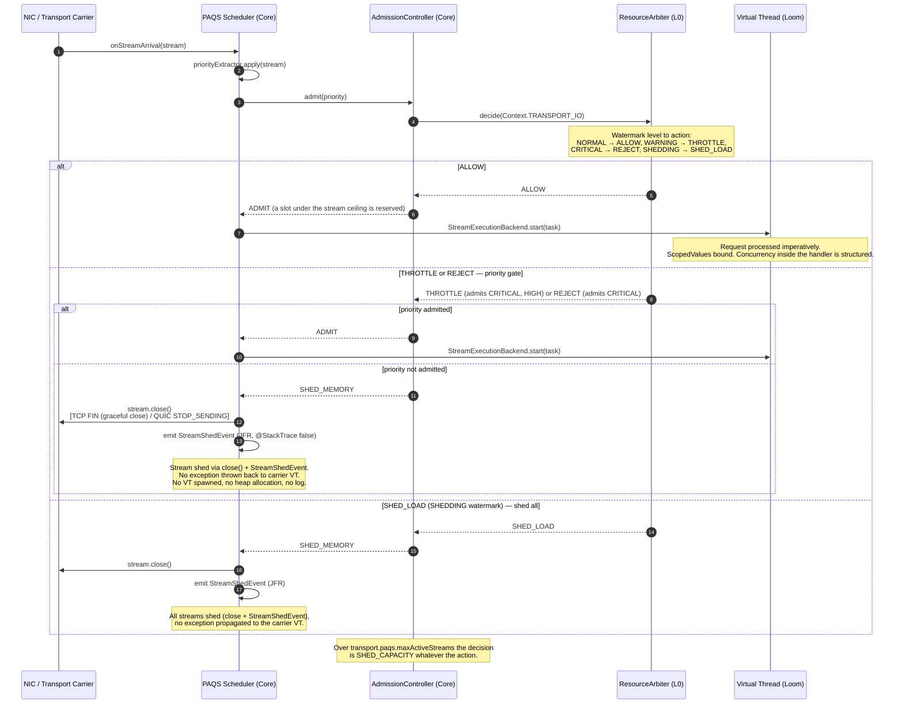

# Kernel Subsystem: Transport (L2 Native I/O)

**Physical Layout:**

- SPI: `eu.exeris.kernel.spi.transport.*` (TransportStream, TransportConnection, TransportProvider, TransportEngine)
- Core: `eu.exeris.kernel.core.transport.*` (PAQS Scheduler, Load Shedding, Stream Lifecycle)
- Drivers:
    - **`community`**: **Exeris Native TCP Carrier** — Custom off-heap TCP/TLS engine built on
      Panama FFM and OpenSSL, designed for Virtual Thread density on standard POSIX networking.

**Layer:** L2 (Native I/O)  
**Status:** Validated Architectural Prototype (TRL-3)

---

## Overview

The **Transport subsystem** is the Kernel's high-density gateway. It rejects legacy reactive event-loops
in favor of a **Virtual Thread-per-Stream** architecture, mapping data from the wire directly into
off-heap `LoanedBuffer` slabs via Panama FFM — no JVM heap contact on the ingress path.

- **PAQS Scheduler:** The **Priority-Aware Queue Scheduler** injects business context at the network edge.
  Low-priority traffic (e.g., telemetry) is shed before any heap state is allocated, preserving resources
  for critical flows (e.g., payments) — the design target. **The shipped Community carrier does not yet
  resolve a per-stream priority**, so this differential shedding cannot occur today; see
  "`StreamPriority` — Origin and Assignment" below.
- **Native Everywhere:** The Community tier rejects Netty and Tomcat entirely. It uses a custom off-heap
  TCP carrier with Panama FFM and OpenSSL, delivering zero object churn on the network hot-path.
- **Protocol Blindness:** Business logic operates on abstract `Stream` objects — oblivious to whether data
  flows over TCP on Windows or QUIC/`io_uring` on Linux.

---

## Connection ceiling

`TransportConfig.maxConnections()` is a hard cap on **concurrent connections across all reactors**,
enforced at accept time in one place, `NativeTcpCarrier.tryReserveConnectionSlot`. When it is reached,
the carrier accepts the connection at TCP level and immediately closes it.

**Which key sets it depends on which carrier you are running, and setting the wrong one is silent**
(ADR-081):

| Carrier | Key | Default | When it exists |
|---|---|---|---|
| HTTP listener | `http.maxConnections` | 4096 | whenever the HTTP subsystem is enabled — the carrier almost every deployment runs |
| Standalone transport | `transport.maxConnections` | 4096 | only when `transport.mode` is set; the subsystem resolves to `DISABLED` otherwise |

The two defaults were 1000 and 4096 until v0.12 — one field, one enforcement point, two numbers, no
stated reason. ADR-081 unified them at 4096, the value the project's own benchmark runs had to raise
the HTTP side to.

**Check `ulimit -n` against this number.** The cap can only refuse cleanly while it is the ceiling
reached *first*. Above the process file-descriptor limit — commonly 1024, below this default — the
operating system's limit is reached first, and its failure mode is worse: see §"Accept-path failure
modes".

What a client observes: the socket opens and then dies, with no HTTP response — a transport-level
failure, not a status code, and indistinguishable from a network fault. **The stream admission
ceiling below behaves the same way**: a shed stream is closed (FIN/RST on TCP, `STOP_SENDING` on
QUIC), not answered. No transport-level path in the kernel refuses with a status; if that is ever wanted it is
a third mechanism above the connection layer, not a replacement for either of these (ADR-081 §2). The
request gate of a developer licence is such a mechanism, and it lives in the HTTP drivers (see
`http.md`, "Developer-licence workload envelope").

Two properties make the ceiling easy to reach at a request rate that feels comfortable. It counts
**concurrent connections, not rate**, so a client whose connection pool overlaps with a draining
previous pool can cross it while neither pool alone comes close. And it is enforced before anything
else — no queue, no shed decision, no response.

Refusals are visible in two places, and were visible in neither before v0.11:

- `TransportStats.totalRejected` includes them. It previously counted only PAQS load-sheds, so it read
  zero during a total accept-time refusal — a value an operator reasonably reads as "this server is
  healthy, look elsewhere".
- `eu.exeris.kernel.transport.CommunityConnectionRefused` is emitted per refusal, carrying the active
  count, the configured ceiling, and a cumulative total whose slope distinguishes a blip from a wall.

## Developer-licence connection ceiling

Under a developer-licence contract every inbound connection also counts against
`WorkloadEnvelope.maxConnections`, through the `WorkloadAdmission` the kernel binds
(`ContractKernelProviders.WORKLOAD_ADMISSION`, ADR-089). The gate is inert until a contract policy selects
the developer gate: the contract gate binds `WorkloadAdmission.UNGATED` otherwise, and under `UNGATED` the
acceptor makes no admission call. The obligations are written on `spi.contract.WorkloadAdmission`,
cross-referenced from `TransportEngine`, and pinned by `AbstractTransportWorkloadAdmissionTck`.

- **Read once, in `start()`.** `NativeTcpCarrier.start()` reads the slot inside the kernel scope and keeps
  it. The acceptor and the reactors are platform threads that inherit no binding, so a read there finds the
  slot unbound and admits everything without a signal.
- **Refusal at accept.** The acceptor asks the gate before it touches an accepted socket. A refused
  connection is closed with no byte written and no TLS handshake started, and counts into
  `TransportStats.totalRejected` through a counter of its own; it emits no `CommunityConnectionRefused` and does
  not move that event's `total`, which describe the `maxConnections` ceiling and would report the wrong one. The gate reports its own first refusal once, as a
  `HARD` contract violation.
- **Exactly one release.** An admitted connection holds one admission beside its connection slot. The
  admission is recorded on the channel's runtime state when the stream is registered, and the single
  lifecycle cleanup in `onStreamClosed` releases it, so reset, idle reclamation, drain and `stop()` all
  release it once. A setup that fails before the stream owns the slot releases both from the acceptor. An
  outbound connection, registered through `connect`, never takes an admission and releases none.
- **Every listener counts.** The HTTP and WebSocket listeners each run their own carrier and share the one
  gate, so their connections add up against a single ceiling.

## Stream admission ceiling

`TransportConfig.maxActiveStreams()` (`transport.paqs.maxActiveStreams`, default
`TransportConfig.DEFAULT_MAX_ACTIVE_STREAMS` = 5000) is a hard cap on **concurrently admitted
streams per engine**, enforced by `AdmissionController.admit` after the memory-pressure decision and
before a virtual thread is spawned. Over the cap the decision becomes `SHED_CAPACITY` whatever the
priority and whatever the watermark says.

This is a different bound from the connection ceiling above, and one is not derivable from the
other: an HTTP/1 connection carries one stream, an HTTP/2 connection carries many.

What a client observes: `StreamLoadShedder` closes the stream and emits
`eu.exeris.kernel.transport.StreamShed` carrying the priority, the decision (`SHED_CAPACITY` rather
than `SHED_MEMORY`) and the active count — so a capacity shed is distinguishable in JFR from a
memory-pressure shed, which is the distinction that says whether raising the ceiling is the right
response.

**What the values mean** (the classification is ADR-071's):

| Value | Meaning |
|:--|:--|
| `> 0` | the ceiling, as given |
| `-1` (`TransportConfig.UNBOUNDED_ACTIVE_STREAMS`) | no stream-count ceiling |
| `0`, other negatives | **refused at startup**, by `TransportConfig` and again by `AdmissionController` |

`-1` removes the count cap, not admission control: the memory-pressure arbiter still decides every
stream first, so an engine configured this way still sheds under watermark pressure. What it gives
up is the ceiling that sheds *regardless* of memory pressure — the point for a JVM-controlled
deployment measuring where saturation actually falls, and a foot-gun for a shared one. `0` is
refused rather than read as "off" because an engine that admits nothing serves nothing.

Both construction sites read the key: the transport subsystem and the HTTP listener, which builds
its own `TransportConfig`. A key honoured on only one of them would apply to a standalone carrier
and not to the server most deployments run.

**Not a knob:** `PaqsScheduler.SPIN_THRESHOLD` has twice been catalogued as a PAQS operational
limit. It is reachable only from `close()`, decides nothing about which streams are served, and
bounds only how the drain spends CPU while it waits — under a drain deadline that is itself
deliberately fixed. It stays a constant.

## Outbound write bound

`TransportConfig.maxQueuedWriteBytes()` (`transport.maxQueuedWriteBytes`, default
`TransportConfig.DEFAULT_MAX_QUEUED_WRITE_BYTES` = 262144) bounds the bytes one stream holds that its
peer has not yet taken before `TransportStream#write` blocks its caller. The limit lives on the
record because every transport tier meets it; the key is how Community's bootstraps fill it, and it has
no `network.*` twin.

| Value | Meaning |
|:--|:--|
| `> 0` | the bound, as given |
| `-1` (`TransportConfig.UNBOUNDED_QUEUED_WRITE_BYTES`) | `write` never blocks for backpressure |
| `0`, other negatives | **refused at startup**, by `TransportConfig` |

`0` is refused rather than read as "off" because a zero bound would block every write: the failure
would be total and silent, so the record fails the boot instead (the third class of ADR-071). The
constructors written before the component existed apply the default, so a caller that never passes a
bound is protected, not left unbounded.

All three sites that build a `TransportConfig` read the key: the transport subsystem and the HTTP and
WebSocket listeners, which build their own. The carrier hands `config.maxQueuedWriteBytes()` to every
stream it builds, accepted or dialled.

## Idle connection reclamation

`TransportConfig.idleTimeoutMillis()` (`transport.idleTimeoutMillis`, and `http.idleTimeoutMillis`
reaching the same carrier through `HttpConfig`, default `HttpConfig.DEFAULT_IDLE_TIMEOUT_MS` =
30 000) closes a connection that has moved no bytes for that long.

**What the values mean** (ADR-071's capacity/timeout class):

| Value | Meaning |
|:--|:--|
| `> 0` | reclaim after this many milliseconds without activity |
| `0` | reclamation disabled — connections are held until the peer or the application closes them |
| negatives | **refused at startup** by `HttpConfig` validation |

**What counts as activity is deliberately asymmetric between the two directions**, and the
asymmetry is the point rather than an oversight:

| Direction | Refreshes the stamp | Does not |
|:--|:--|:--|
| ingress | the application calling `read()` | bytes merely *arriving* in the inbound queue |
| egress | `write()` / `queueWrite()`, **and** bytes actually leaving the socket — the direct write, the reactor's deferred drain, and the TLS drain | — |

On ingress, only an attempted read counts. A peer that opens a connection and sends nothing never
causes one, so the same stamp that expires an idle keep-alive also bounds a slow-loris hold: a
handler parked in `read()` for a body that never arrives has not refreshed its stamp since the read
began. **Stamping on arrival would defeat exactly that** — dribbling one byte per second is what a
slow-loris does, and a connection nobody is reading is not doing work.

On egress the opposite is required: bytes leaving *are* the server doing work for this connection,
so a large response draining to a slow client keeps its own connection alive rather than being cut
off mid-transfer. `write()` reaching `queueWrite` only on the TLS branch is what made this wrong in
the first cut — plaintext responses, which is `CommunityHttpExchange`'s path and the default one,
moved bytes without counting, and idle reclamation became a property of whether TLS was configured.

**The sweep is per reactor and rides a wake-up that was going to happen anyway.**
`NativeTcpIdleReaper` runs inside the reactor's select loop after the selected keys are dispatched
— no timer thread, no scheduled task, and no state shared between reactors. It is gated to
`idleTimeout / 4` clamped to [250 ms, 5 s], because a reactor returns from `select` thousands of
times a second under load and an ungated O(keys) walk would put a scan of the whole connection set
on the hot path to enforce a limit measured in seconds. The same cadence shape, for the same
reason, governs `CommunityTenantPoolRegistry`'s pool reclaim.

**Teardown is abortive**, through the same `closeKeyStream` path as a dispatch fault. A graceful
close waits for queued egress to drain, and a peer quiet enough to be reclaimed is exactly the peer
that may never drain it.

What an operator observes: `eu.exeris.kernel.transport.CommunityConnectionIdleTimeout`, carrying
the stream id, the reactor index, the observed idle span and the configured timeout. Both spans are
on the event because the ratio is the interesting quantity — idle spans clustered just past the
limit mean a fleet being trimmed on a threshold, spans minutes past it mean genuinely dead peers.

> **This limit did nothing before 0.12.0.** It was read from configuration, validated, carried
> through `HttpConfig` into `TransportConfig` and rendered by `toString()`, and never compared to
> anything: no code read `idleTimeoutMillis()` outside construction. A knob that is carried but
> unconsumed is worse than a missing one, because the missing one is discoverable — the operator
> who sets it sees it echoed back and concludes it works.

## Accept-path failure modes

There are two ways an accepted connection ends without being served, and they look identical from the
client: the socket opens and dies. They are different in kind, and the kernel now distinguishes them.

| | Refusal | Setup fault |
|---|---|---|
| Event | `CommunityConnectionRefused` | `CommunityAcceptFault` |
| Cause | the connection ceiling was reached | something threw while configuring the channel, resolving the peer, building the stream, or registering it |
| Nature | a **policy** decision at a known limit | a **defect** — allocator failure, TLS engine that would not initialise, registry inconsistency |
| In `totalRejected` | yes | **no** |
| Counted on `TransportStats` | `totalRejected` | `acceptFaults` (since 0.12.0) |

A setup fault is deliberately **not** counted as a refusal. `totalRejected` means work the engine
*declined*, and a setup that broke declined nothing. Folding the two together would leave an operator
reading a spike unable to tell a capacity problem from a bug — the one distinction that changes what
they do next. Until 0.12.0 the fault count reached an operator only inside the JFR payload, so the two
modes were documented together but not *observable* together; `TransportStats.acceptFaults` closes
that (ADR-081 §5). A driver with no accept-setup path reports `0`.

Both paths recover: the accept loop continues. That is correct for a per-connection failure, and
making a setup fault fatal would trade a silent drop for an outage. What changed is only that neither
is silent.

**A third mode is neither of these, and since 0.12.0 it recovers.** An `IOException` from `accept()`
itself — how file-descriptor exhaustion (`EMFILE`) surfaces — is the *listener* failing to produce a
connection, not one connection failing to be set up. Until 0.12.0 it was fatal: `runAcceptorLoop`
called `handleAsyncFailure` and returned, so a process that touched its `ulimit -n` once needed a
restart to serve again, from a condition that clears on its own as connections close.

| | Accept retry |
|---|---|
| Event | `CommunityAcceptRetry` |
| Cause | `accept()` itself threw — descriptor exhaustion, an aborted connection |
| Nature | a **transient** condition affecting the listener rather than a connection |
| Response | pause and try again; `25ms × streak`, capped at 1s |
| Bound | 64 consecutive failures are retried; the 65th takes the fatal path |

**Every `IOException` is retried rather than a list of transient ones**, and that is deliberate. Java
offers no typed signal — `EMFILE` arrives as a plain `IOException` — so classifying means matching on
a message, and a message that does not match on some JDK, OS or locale reinstates the defect. The two
mistakes are not symmetric: retrying a fatal condition costs a bounded delay before the same outcome,
while declining to retry a transient one loses the listener. The ceiling does the work classification
would have done, and the event's streak is what separates one retry from a process that is not
recovering.

**What ends a streak is an accept that returned a socket**, counted at the accept itself rather than
inferred from how a pass finished. The distinction is the one descriptor pressure actually produces:
descriptors free one at a time, so a pass accepts a connection and then throws probing for the next.
It leaves by the throw, so a streak built from what the pass *returned* would climb to the ceiling
while the listener was demonstrably still serving. An accept the connection cap then refuses counts
too — what it witnesses is the listener working, which is a different question from whether the
connection was served.

The connection ceiling above still asks you to check `ulimit -n`. The cap refusing is the good
outcome, and the OS limit winning the race is now survivable rather than terminal — but it is still
the worse of the two.

The fault event carries the exception **class** and never its message, matching
`CommunityReactorDispatchFault` — a message can carry request-derived text.

## Client TLS

A listener serves TLS when it holds certificate material. The ALPN list it offers is set by its owner: the HTTP listener offers `h2` then `http/1.1` when `http.maxVersion` permits HTTP/2 and `http/1.1` alone otherwise (`NativeTcpTransportProvider#createEngine(TransportConfig, CommunityOutboundTls, List<String>)`); a carrier built without a list offers `h2` then `http/1.1`. A listener selects only a protocol its list names; the WebSocket listener's list is `http/1.1` alone, so a WSS listener never selects `h2`. What a `CLIENT` or `DUAL` carrier does with its **outbound** connections is decided once, when `NativeTcpTransportProvider` builds it:

| Posture | When | Outbound connections |
| :-- | :-- | :-- |
| `VERIFIED` | `exeris.transport.tls` is not `false`, a crypto provider is bound where the carrier is built, and — for `DUAL` — the listener holds material | TLS, verifying the server (below) |
| `PLAINTEXT_DECLINED` | `-Dexeris.transport.tls=false` | plaintext |
| `PLAINTEXT_NO_CRYPTO_PROVIDER` | no crypto provider bound where the carrier is built | plaintext |
| `PLAINTEXT_NO_LISTENER_MATERIAL` | a `DUAL` carrier whose listener has no certificate | plaintext |
| `REFUSED_FOREIGN_PROVIDER` | the bound crypto provider is not the Community one, so it cannot verify an outbound peer | a `CLIENT` carrier fails construction (`EX-NET-4004`); a `DUAL` carrier's `connect` fails before any socket opens (`EX-NET-4001`, cause detail `bound crypto provider cannot verify an outbound peer`) |
| `PLAINTEXT_REQUIRED` | the carrier's owner requires plaintext (`CommunityOutboundTls.PLAINTEXT`, below) | plaintext, whatever crypto provider is bound |
| `REFUSED_DECLINED` | the owner requires verified TLS (`CommunityOutboundTls.VERIFIED`) and `-Dexeris.transport.tls=false` | none: the carrier fails construction (`EX-NET-4004`, `the peer requires TLS, and exeris.transport.tls=false declines it`) |
| `REFUSED_NO_CRYPTO_PROVIDER` | the owner requires verified TLS and no crypto provider is bound | none: the carrier fails construction (`EX-NET-4004`, `the peer requires TLS, and no crypto provider is bound`) |

Each decision is recorded as `eu.exeris.kernel.transport.TransportTlsClientPosture` and an INFO log
line, with the owner's requirement, where the trust came from, whether the kernel configuration was
bound, and — for OpenSSL's default trust — the effective default file and directory and whether
either exists (a WARNING when neither does). The decision matters because it is invisible from
outside: an engine built outside a booted kernel's scope, or before its crypto subsystem binds, dials
plaintext.

**The owner's requirement.** An owner that knows the scheme of the peer its `CLIENT` carrier dials
states what the carrier's outbound connections must be, through
`NativeTcpTransportProvider#createEngine(TransportConfig, CommunityOutboundTls)`. That method is
Community's own, not a `TransportProvider` method, and a requirement other than `AMBIENT` on any mode
but `CLIENT` throws `IllegalArgumentException`. `AMBIENT`, which `TransportProvider#createEngine`
passes, is the decision in the table. `PLAINTEXT` dials plaintext whatever is bound. `VERIFIED`
verifies the server as a `VERIFIED` carrier does, or fails construction with `EX-NET-4004` and
records why, checked in this order: `REFUSED_DECLINED`, `REFUSED_NO_CRYPTO_PROVIDER`, then
`REFUSED_FOREIGN_PROVIDER` (detail `bound crypto provider cannot verify an outbound peer`). It never
dials plaintext. A configured `crypto.tls.client.trustFile` is checked under every requirement, as it
is when TLS is not armed. The S3 blob client and the OIDC provider's JWKS fetch state the
requirement their endpoint's scheme names (`CommunityEndpointScheme`): `PLAINTEXT` for `http://`,
`VERIFIED` for `https://` ([storage.md](storage.md#s3-compatible-driver-notes),
[security.md](security.md)).

A verifying carrier opens one trust store — `crypto.tls.client.trustFile`, else OpenSSL's default —
and shares it across its connections; `close()` gives up the carrier's reference, and each engine
built from the store holds its own, so the store is freed when the last of them closes.
`connect(host, port)` classifies `host` before any socket opens: a host that is neither a DNS name
nor an IP literal fails with `EX-NET-4001` (cause detail
`authority host is neither a DNS name nor an IP literal`). The connection's engine verifies the
server's chain against the trust and its subject alternative names against `host`, as
[crypto.md](crypto.md#client-peer-verification) describes. A `DUAL` carrier dials as a client too;
only accepted connections use the listener's material.

The handshake runs on the stream's first read or write, on whichever thread drives it — often a
reactor. A failure is recorded under the stream's TLS lock before the stream closes, and every later
`read`, `write` or `queueWrite` throws it as `TlsHandshakeException` (`EX-NET-2001`), built on the
caller's thread: detail `peer certificate verification failed` with the `X509_V_*` code, or
`handshake failed` with the `SSL_get_error` code.

## Core Philosophy

### 1. Carrier Loop Architecture

Transport logic centers around dedicated **Carrier Loops**. Each loop manages native sockets, task queues
(JCTools `MpscUnboundedArrayQueue` — see "Load Tests" below), and off-heap memory pools reached
through `MemoryAllocator`, in a tight, non-blocking execution cycle.

The relationship between Carrier Loops and Virtual Threads is deliberate:

- **Carrier Loop:** Owns the native I/O rings. Wakes Virtual Threads when data is ready. Never executes
  business logic.
- **Virtual Thread:** Executes business logic imperatively. Parks on I/O waits. Carrier Loop resumes it
  at zero OS context-switch cost.

This separation gives you the simplicity of blocking, imperative code with the performance of a native
event loop.

### 2. PAQS: Business Context at the Network Edge

PAQS is the enforcement arm of the `ResourceArbiter`. When `WatermarkManager` signals memory pressure,
PAQS raises the shedding threshold — streams below that priority are dropped at the transport edge before
a single byte enters the application stack. This prevents GC pressure from cascading into business logic.

### 3. Zero-Copy Ingress

The Community carrier transfers bytes from the network socket directly into off-heap `LoanedBuffer` slabs via Panama FFM. No intermediate `byte[]`, no `ByteBuffer.allocate()`, no heap serialization.

---

## Responsibilities

**What Transport SPI DOES:**

1. Define the `TransportStream` and `TransportConnection` lifecycle interfaces.
2. Provide `TransportProvider` and `TransportEngine` for native driver registration via `ServiceLoader`.
3. 🚧 **Planned (TRL-4):** Define `StreamHeaders` SPI interface for protocol-blind header access. Not yet implemented — current header access is via `TransportStream` implementation directly.
4. Define `StreamPriority` enum consumed by the PAQS Scheduler.

**What Transport Core DOES:**

1. Implement the **PAQS Scheduler** and global Load Shedding logic.
2. Coordinate with `ResourceArbiter` to monitor `SlabPool` exhaustion and trigger backpressure.
3. Manage Virtual Thread lifecycle (one per incoming stream), through the injected
   `StreamExecutionBackend` seam (`@since 0.11`) rather than a direct call in `PaqsScheduler` — the
   default backend spawns via `Thread.ofVirtual().start()`, the sole deliberate exception to the
   structured-concurrency mandate. `StructuredTaskScope.fork()` enforces `WrongThreadException` for
   any caller that did not open the scope; since `schedule()` is called concurrently by multiple
   carrier threads (NIO selectors, io_uring rings), a shared long-lived STS is architecturally
   incompatible with the multi-carrier ingress model. These unstructured VTs act as roots of the
   Request Tree. Concurrency *within* the stream handler must still be structured, but the mechanism
   is track-dependent (ADR-066), and this is not the `StructuredTaskScope` mandate stated generically
   elsewhere: the default distribution line uses `core.concurrent.StructuredScope` (GA APIs only,
   no `--enable-preview`); `StructuredTaskScope` itself is reserved for the `preview` branch, per
   `PaqsScheduler`'s own class-level contract.
4. Expose cross-platform POSIX / Winsock socket symbol loading via `CoreSyscallLoader` (Panama FFM).
   The POSIX half of that seam is exercised end-to-end since 0.11 (`SyscallLoopbackRoundTripIT`,
   below); the Winsock half has never run, because CI carries no Windows runner.

   **The Community carrier is not simply "NIO-backed": which of the two paths carries plain-TCP
   data is decided at runtime.** `NativeTcpStream`'s read and write paths each choose between
   `NativeTcpStreamPlainSocketIo.seamRead` / `seamWriteWithNioFallback` — POSIX `recv` / `send`
   invoked through Panama FFM on the file descriptor lifted out of the `SocketChannel` — and
   `nioFallbackRead` / `nioFallbackWrite`, which use the channel directly. `NativeTcpSocketBackend`
   arms the first only when all three of `SyscallHandles.supportsPlainSocketIo()`,
   `SocketChannelFdAccess.isRuntimeFdAccessAvailable()` and *not* `hasIoctlsocket()` (the Winsock
   model) hold. NIO always owns the selector and the accept path; only the data path moves.

   The middle condition is the one an operator controls, and it is off by default. Measured on
   JDK 25.0.3-tem, `isRuntimeFdAccessAvailable()` returns `false` on a plain JVM and `true` under
   `--add-opens java.base/sun.nio.ch=ALL-UNNAMED --add-opens java.base/java.io=ALL-UNNAMED`.
   Those are the same two flags `docs/subsystems/crypto.md` recommends so that the Community TLS
   pipeline can bind an OpenSSL BIO to the socket descriptor — so **an operator who follows that
   TLS guidance also moves plain-TCP data I/O from NIO onto the POSIX path**, and nothing in either
   document previously said so. This module's own test suite runs with those flags in its surefire
   `argLine`, which means the POSIX path is the one the tests exercise and the NIO fallback is the
   one a default run takes.

---

## Provider Selection — Descending Priority + First-Available

`CommunityTransportSubsystem` resolves a `TransportProvider` at bootstrap via the shared
`BootstrapProviderSelector.loadHighestPriority(...)` helper with the availability filter
`TransportProvider::isAvailable`. Selection semantics:

1. **Discovery:** all `TransportProvider` implementations on the classpath are loaded via `ServiceLoader`.
2. **Availability filter:** providers for which `isAvailable()` returns `false` are removed from the
   candidate set. Platform-conditional providers (e.g., io_uring on Linux only, IOCP on Windows only)
   gate themselves here. The default `isAvailable()` returns `true`.
3. **Descending priority + deterministic tie-break:** remaining candidates are ranked by
   `priority()` (higher wins). On ties, the implementation class name (alphabetical, last wins under
   `Stream.max`) breaks the tie deterministically across JVMs and ServiceLoader orderings.
4. **First-available wins:** the highest-priority available provider is selected. If the candidate
   set is empty, no transport engine is created and the subsystem stays in `DISABLED` mode.

This means an unavailable higher-priority provider (e.g., io_uring on a non-Linux host) does NOT
shadow an available lower-priority provider (e.g., NIO Community baseline). The selection contract
is exercised by `BootstrapProviderSelectorTest` and validated end-to-end through the
`CommunityTransportSubsystemLifecycleTckTest` binding.

---

## Stream lifecycle and wakeups

A `NativeTcpStream` can end through several routes, and a thread parked on it, whether a reader in
`read`, a writer or a caller waiting for the reactor registration, has to learn of each one. The
rules below are the contract between the terminal paths and the waiters. They describe the Community
native TCP stream only; an Enterprise transport meets the same observable obligations through the
`AbstractTransportStreamTck` terminal-wake cases, not through this mechanism. A TLS write that meets a
full send buffer does not end the stream: it stalls, as described in [TLS write stall](#tls-write-stall).
Only a fatal TLS wrap status ends the stream, and it goes through the rules below as an abort.

The cost is a wake on every terminal transition, not only on the one that wins: each call reads three
waiter slots and unparks the threads it finds, so a waiter may receive a surplus permit, which its park
loop absorbs by re-checking its condition. Nothing is allocated, and the steady-state read and write
paths gain one extra flag read.

**Rules**

1. **Wakers never clear a waiter's registration.** A thread records itself as the stream's reader,
   writer or registration waiter, and removes its own record when it leaves. A terminal transition
   reads the record and unparks the thread; it does not take the record away, so a second terminal
   transition reaches the same thread again.
2. **Flag first, then wake.** Every transition in the table writes its flag and then wakes all
   waiters, whether or not this caller won the compare-and-set on that flag. The wake is not gated on
   a "parked" hint: those hints serve the data path, and a surplus permit is harmless because every
   park loop re-checks its own condition.
3. **Park conditions name every terminal flag.** The reader stops waiting when the stream is
   closed, a close was requested, the remote end was observed, or data arrived. A writer parked at the
   outbound bound stops when the stream is closed, a close was requested, or the queue has drained to
   the resume mark; it does not stop on the remote end alone, because a FIN is a half-close. A reader still
   completing the TLS handshake stops on a requested close too. A `read` that finds a close requested
   discards what is queued inbound, then reports end of stream if the remote end was observed and
   otherwise throws `EX-NET-4009`, the same answer a write gets from the same state. One exception:
   after a send-failure abort that follows the peer's end, bytes the peer sent first stay readable
   and end of stream comes only after them, because the abort is this side's consequence of the
   peer's end. A later `close()` or `reset(long)` by the application ends that and discards them; an
   abort raised as the closed signal on the writer's thread does not end the survival: only the
   application's `close()`/`reset(long)` does.
4. **No early return without a wake and a finish attempt.** A repeated `close()` or `reset(long)`
   wakes the waiters and tries to finish the teardown again; a repeated `reset(long)` that cannot
   finish also asks the reactor to do it.
5. **An abort finishes where it happens.** A send failure sets the abortive flags, abandons the
   queue and wakes the waiters while the failing thread holds the outbound consumer slot. The
   abort's terminal close runs after that thread releases the slot. The finishes that
   `flushPendingWrites` itself runs at the end of a drain or on a stall run under the slot, which
   rule 6 makes safe.
6. **The consumer gate is re-entrant.** Entering the inbound or outbound slot reports whether the
   call acquired it or its thread already held it, and only an acquiring call releases. A cleanup
   nested under a holder therefore leaves the holder's slot alone.
7. **The finish wakes once more.** The transition that sets `closed` wakes all waiters again, as the
   last transition of the stream.

**Transitions**

| Event | Flags set | Wakes | Finish |
|:--|:--|:--|:--|
| `close()` (any call) | `closeRequested` | all | now, if the slot is free and the queue is drained; otherwise whoever releases the slot, or the reactor's drain |
| `reset(long)` (any call) | `resetRequested`, `closeRequested` | all | now, if the slot is free; otherwise the reactor is woken to do it |
| Send failure on a queue drain: a write `IOException`, or a fatal TLS wrap status (`CLOSED`, which never re-enters `close()` under the slot) | `resetRequested`, `closeRequested`; `peerEndedFirst` when the remote end was already observed, the send's errno says the peer reset (`EPIPE`/`ECONNRESET`, core-socket seam, or the errno of a fatal TLS wrap status) or, on the NIO fallback, the channel failed on a send for any reason but a local close, or a TLS wrap found the session ended by the peer, and no local close came first; the remote end is then recorded (`markRemoteClosed`), and the writer receives the closed signal with the `EX-NET-4002` failure as its cause | all | after the failing thread releases the slot |
| Send failure on a direct write (plain, nothing queued) after the peer ended | `remoteClosed`, `peerEndedFirst` if no local close came first | all | none: the application's close ends the stream |
| Peer FIN or TLS `close_notify` (`markRemoteClosed`) | `remoteClosed`; `peerEndedFirst` when no local close was requested | all | none |
| Carrier teardown (`closeKeyStream`: dispatch fault, idle reap) | `markRemoteClosed`, then `reset(long)` | all | through `reset(long)` |
| The finish succeeds | `closed` | all | none |
| TLS wrap `NEED_WRAP` or `NEED_UNWRAP` (a stall) | none | none | none |
| A drain step that takes the queue from above the resume mark to at or below it | none | the parked writer | none |

A peer FIN is a half-close: it ends the reader's input but does not end writes, so a writer woken by
it re-checks its condition and keeps waiting, and a write after it is still sent. A TLS `close_notify`
is not: the Community engine refuses a wrap after the peer's `close_notify`, so the next drain ends the
stream and reports `EX-NET-4008`; TLS 1.3 half-close is not supported. A reactor-side flush that meets
the peer's end does not reach the reactor's dispatch-fault path; the stream finishes its own abort and
the writer's next call reports the signal.

A thread that wants to wait on the stream's terminal state registers itself the way `read` does and
checks every flag in the table after registering and before parking. A write made on a reactor thread
queues past the outbound bound instead of parking, because a reactor serves every stream it owns and
must not wait on one stream's peer; see [Outbound backpressure](#outbound-backpressure).

## Outbound backpressure

`TransportStream#write` blocks its caller while the stream holds too many bytes its peer has not
taken; `TransportStream#queueWrite` never does. Both feed one byte counter per stream, so the bound
sees everything queued, and only `write` waits on it.

**Arithmetic.** For a bound `B > 0`: the chunk cap is `C = max(1, B / 2)` and the resume mark is
`L = B - C`. `write` enqueues one chunk at a time and only while the queued bytes sit at or below `L`,
so what `write` queues never exceeds `B`; `queueWrite` ignores the bound and may push the count past
it. That is memory accounting, not a wait.

**Wake.** The counter is raised before an entry is offered and lowered where an entry leaves the queue,
whether it was sent or abandoned. The step that takes the count from above `L` to at or below `L`
wakes the parked writer; every path from above `L` to at or below it contains such a step, so no wake
is lost to the increments in between. A fixed chunk cap keeps a TLS stream from cutting one-byte
records when the queue sits just under the bound, and each chunk is a pending write of its own, so the
retry rule of the [TLS write stall](#tls-write-stall) holds unchanged.

**Who waits.** The caller of `write`, on its own thread, holding no monitor and not the outbound slot.
Never a reactor thread: the reactors run their loop with a scoped marker, and a write made under it
queues past the bound. One thread at a time may park as a stream's writer; a second that would park
gets `IllegalStateException`, while a second that finds room is unaffected. A parked writer that is
interrupted gets `IllegalStateException` with its interrupt status restored. A parked writer is
released by any terminal transition of the stream with the closed-stream signal: `EX-NET-4009` for the
application's own close or reset, `EX-NET-4008` when the peer or a carrier teardown ended it first.

**Liveness.** There is no deadline in the wait. A peer that never reads is bounded by the idle sweep
(`transport.idleTimeoutMillis`), whose reclaim resets the stream and so wakes the writer with
`EX-NET-4008`. With `idleTimeoutMillis = 0` a writer to a peer that never reads waits until the stream
is closed or reset.

**Release is the credit.** A loan handed to `queueWrite` is released once its bytes have left the
outbound queue, or when the stream ends, and not before. A caller that must not block bounds the loans
it has outstanding by those releases.

**Telemetry.** A write that parks emits one `TransportWriteParkEvent` before its first park.

## TLS write stall

A TLS stream's write goes through `SSL_write` on the socket-owner BIO. When the kernel send buffer is
full, OpenSSL reports `SSL_ERROR_WANT_WRITE`, which the engine maps to `NEED_WRAP`. That is back
pressure from the peer, not a failure, so the head entry of the outbound queue stays queued and the
drain reports a stall. The stream stays open, no waiter is woken and nothing is abandoned.

- **`NEED_WRAP` arms write interest.** The caller that sees the stall asks the reactor for
  `OP_WRITE`: `queueWrite` does so when data is still queued after its flush, and the reactor keeps
  `OP_WRITE` set while its own flush does not drain. When the socket becomes writable again the
  reactor retries the head entry.
- **The retry is the same call.** The engine's context sets neither `SSL_MODE_ENABLE_PARTIAL_WRITE`
  nor `SSL_MODE_ACCEPT_MOVING_WRITE_BUFFER`, so OpenSSL accepts a retry only with the same plaintext
  address and the same length. A stalled head entry is therefore never re-cut, merged with a
  neighbour, resized or reallocated, and its prepared flag stays unset until the record layer has
  accepted every byte. A retry with other arguments is a fatal bad-write-retry, which the engine
  reports as `CLOSED`.
- **`NEED_UNWRAP` from a wrap is a stall that does not arm write interest.** The engine waits for the
  peer, for example during a renegotiation the peer started, and a writable socket would only make the
  reactor spin. The reactor's own flush drops `OP_WRITE` for such a write. The carrier's TLS ingress
  loop flushes the queue after each readable event while a write waits for the peer, and re-arms write
  interest only if the head entry then stalls on the socket. Two windows would lose that flush, and
  both are closed. The wait is recorded under the TLS lock, in the same critical section as the wrap,
  so an ingress read that takes the lock afterwards always sees it. An ingress flush that finds the
  outbound slot held leaves a retry request, and the holder, after releasing the slot on a stall,
  flushes once more. A graceful `close()` while a write waits for the peer finishes when the peer's
  next record arrives, or when the idle reclamation resets the stream.
- **A fatal status aborts.** `CLOSED` from a wrap (a broken connection, a reset, a protocol error)
  abandons the queue under the outbound slot, wakes every waiter and ends the stream, so a queued
  write is never lost silently and no waiter hangs. The failure (`EX-NET-4002`; `EX-NET-4008` with
  `EX-NET-4002` as cause when the peer had ended the stream) is thrown to the writer when its own
  thread runs the drain. A retry that the reactor runs instead ends the stream
  through the reactor's teardown when the peer had not ended the stream; when it had, the reactor's flush
  swallows the signal and the stream finishes its own close. Either way the writer's next call reports
  the closed signal. The abort's
  terminal close runs after the slot is released; it never re-enters `close()` from under the slot.
- **A stall across the peer's `close_notify`.** The retry finds the session ended, abandons the queue,
  releases its loans and ends the stream. The bytes are not delivered, and the writer's next call
  reports `EX-NET-4008`. There is no abortive dispatch-fault teardown.
- **Allocation.** A stall allocates nothing. `write()` makes one private copy of the caller's bytes,
  at enqueue; `queueWrite` makes none.

The tests wait on the stall as an event: a test-only hook runs on every stall, so no test polls for a
full send buffer. `NativeTcpStreamTlsBackpressureTest` scripts `SSL_write` results and records the
address and length of each call; `CommunityHttp1TlsSlowReaderTest` sends a 4 MiB HTTP/1.1 body over TLS
to a client that reads nothing until the stall, with an 8 KiB send buffer, and checks the body byte for
byte; `CommunityHttp2TlsStreamExchangeTckTest` binds the stream exchange TCK over TLS with ALPN `h2` and fails its backpressure probe unless at least one TLS write stalled.
The last two are in the `stream-loopback` group.
`NativeTcpTlsSendBufferStallIntegrationTest` is not: it writes 16 MiB through a Community server to a JDK client that reads nothing until the stall, checks the SHA-256 of what arrives and that the stream stayed open, and runs in the default build and in the TLS matrix, so the stall is exercised against the real OpenSSL binding in CI.

## Error Codes

> **Source of truth:** `KernelErrorCodes.java` in `exeris-kernel-spi`.

| Code          | Meaning                  | Glass-Box Payload (`rawArgs`)                                               |
|:--------------|:-------------------------|:----------------------------------------------------------------------------|
| `EX-NET-4001` | Bind / Handshake Failure | `[0] String transportName, [1] int port`                                    |
| `EX-NET-4002` | Send Failure             | `[0] String transportName, [1] long bytesSent`                              |
| `EX-NET-4003` | Receive Timeout          | `[0] String transportName, [1] long timeoutMs`                              |
| `EX-NET-4004` | Engine Bootstrap Failure | `[0] String transportName, [1] String reason`                               |
| `EX-NET-4005` | Engine Start Failure     | `[0] String transportName, [1] int port` — thrown by `TransportException.engineStartFailure`; port-in-use is one cause among several (e.g. carrier loop thread creation failure) — **Fatal:** check OS process list when the port is the cause |
| `EX-NET-4006` | PAQS Load Shedding       | `[0] String transportName, [1] long streamId` — the exception carrier's schema (`TransportException.streamShed`); the JFR `StreamShedEvent` recorded on both shed paths carries typed fields (`streamId`, `priority`, `shedReason`, `engineName`, `activeStreamCount`) instead, read by name, not by this `rawArgs` layout |
| `EX-NET-4007` | Buffer Exhaustion        | Reserved — no kernel code path raises it, so it publishes no `rawArgs` layout |
| `EX-NET-4008` | Transport Stream Closed By Peer | No `rawArgs` — thrown as `TransportStreamClosedException` (an `IllegalStateException` subclass); the remote end was observed, or the transport tore the stream down, before the stream was closed through this endpoint |
| `EX-NET-4009` | Transport Stream Closed Locally | No `rawArgs` — same thrower; the stream was closed through this endpoint first |

**Operational note for `EX-NET-4006`:** This is a deliberate, non-fatal policy decision — not a hardware
failure. No connection state or heap object is allocated for the shed stream. It MUST emit a JFR event
(`eu.exeris.kernel.core.transport.jfr.StreamShedEvent`) but must not increment error counters used for alerting.

**Closed-stream signal (`EX-NET-4008` / `EX-NET-4009`).** A `read`, `write` or `queueWrite` on a closed
`TransportStream` throws `TransportStreamClosedException`, an `IllegalStateException` subclass. `EX-NET-4008`
means the transport had observed the remote endpoint end the stream, or had torn the stream down itself
without a local `close()`/`reset()` request, before the stream was closed through this endpoint. `EX-NET-4009`
means the stream was closed through this endpoint (`close()`, `reset(long)`, or the parent connection's
`close()`) first. The first side to end the stream decides the code: a peer end followed by a local close
reports `EX-NET-4008`, and a local close followed by a peer end reports `EX-NET-4009`. A `read` that can still
report end of stream returns `-1` instead of throwing. `PaqsScheduler`
records a handler ending with `EX-NET-4008` as `StreamLifecycle` outcome `PEER_CLOSED`, logs it at DEBUG with
the stream id and engine, and emits no `PaqsHandlerFailure`. It classifies the thrown object only, never its
cause chain or the stream's state: a wrapper means an intermediate layer made the closed signal its own
failure, so walking causes would let a genuine failure that follows a disconnect be downgraded; and protocol
layers own their closed signals, which Core, being protocol-blind, cannot classify. `EX-NET-4009` stays a
handler failure. The Community carrier also reports `EX-NET-4008` for a stream it reclaims idle or tears
down after a connection fault, because it marks those streams remote-closed.

A send that fails because the peer ended the stream raises the signal as well, with the `EX-NET-4002`
transport failure as its cause. The core-socket seam recognises the peer's end by the send's errno
(`EPIPE`, `ECONNRESET`) or by an end the carrier already observed. A TLS stream does the same through the
errno that its fatal wrap status left: in fd-owner mode OpenSSL writes to the socket itself, and the engine
reads errno once, right after `SSL_get_error` reports `SSL_ERROR_SYSCALL`. Windows does not read it, so
there only an end the carrier already observed is recognised. The NIO fallback has no errno and its
exception messages are locale text, so there a send that fails on the channel for any reason but a local
close (a `ClosedChannelException`) is read as the peer's end: the connection is gone, and the stream is
aborted either way.

---

## Code Examples

### 1. PAQS Priority Gate (Core) — shape of `PaqsScheduler.schedule`

```java
public void schedule(TransportStream stream) {
    StreamPriority priority = priorityExtractor.apply(stream);
    AdmissionController.Decision decision = admissionController.admit(priority);
    if (!decision.isAdmit()) {
        loadShedder.shed(stream, priority, decision, admissionController.activeStreamCount());
        // stream is closed and StreamShedEvent is emitted — no exception propagated
        return;
    }
    executionBackend.start(threadName, () -> streamHandler.handle(stream));
}
```

> `admit(priority)` is O(1) — one `ResourceArbiter.decide` call plus a CAS loop against the active-stream
> ceiling. No heap allocation occurs for shed streams. `executionBackend` defaults to
> `Thread.ofVirtual().start(...)`; no Virtual Thread is created on the shed path.

### 2. Protocol-Blind Stream Handler (SPI)

```java
package eu.exeris.kernel.spi.transport;

public interface StreamHandler {
    void handle(TransportStream stream);
}
```

---

## PAQS Decision Flow (Full Sequence)

The diagram below shows the complete path of an incoming stream through the PAQS admission gate —
from NIC arrival through the WatermarkManager check to either Virtual Thread fork or shed.



> The `priorityExtractor` step above is illustrative of the target design (see the caveat under
> "`StreamPriority` — Origin and Assignment" below): the shipped Community carrier's extractor ignores
> the stream and always returns `NORMAL`, so under `THROTTLE` and `REJECT` the priority gate currently
> sheds every stream on an engine uniformly rather than differentiating by priority.

---

## `StreamPriority` — Origin and Assignment

`StreamPriority` is not self-declared by the client. It is **assigned by the Kernel** at the transport
edge based on verifiable attributes — that is the target design. The priority assignment chain:

> **Not implemented in the shipped Community carrier.** `NativeTcpCarrier.initPaqs()` wires the
> `PaqsScheduler` with a constant extractor, `stream -> StreamPriority.NORMAL`, ignoring the stream
> entirely — none of the four sources in the table below is read. `network.paqs.endpointPriority.<path>`,
> the config key the third row depends on, is itself listed 🔲 planned (not wired) in
> [config.md](config.md). Every stream a Community engine admits today carries `NORMAL`, so the
> differential shedding this table and the Overview describe cannot happen against this build; the
> table states the intended resolution chain, not current behavior.

| Source                             | Mechanism                                                                                         | Trust Level        |
|:-----------------------------------|:--------------------------------------------------------------------------------------------------|:-------------------|
| **Authenticated principal attribute** | Derived from the validated `PrincipalContext` provided by `SecurityProvider` before PAQS admission (for example, from a token claim or directory attribute). Cannot be client-forged once authentication succeeds. | High (verified) |
| **HTTP/QUIC stream header `x-priority`** | Mapped to `StreamPriority` enum by transport carrier. Treated as **untrusted input** — capped at `NORMAL` unless an authenticated principal attribute (see above) overrides. | Low (untrusted) |
| **Endpoint configuration**         | Static mapping via `network.paqs.endpointPriority.<path>` config key. Overrides header. | High (operator) |
| **Default (no source)**            | `StreamPriority.NORMAL`                                                                         | N/A               |

**Priority enum (SPI):**

```
enum StreamPriority {
    CRITICAL,   // payments, health checks, ops — never shed except at SHEDDING watermark
    HIGH,       // premium tier, authenticated business flows
    NORMAL,     // default — most application traffic
    LOW,        // lower-value application traffic, batch jobs, analytics
    TELEMETRY   // observability-only streams, fire-and-forget metrics/logs
}
```

> **PAQS invariant:** Priority is evaluated **once** at stream admission. It cannot change mid-stream.
> This ensures O(1) shed decisions with zero re-evaluation overhead.

---

## Connection Draining Policy

When PAQS sheds a stream or the Kernel initiates graceful shutdown:

| Scenario               | Community (TCP)                                     |
|:-----------------------|:----------------------------------------------------|
| **PAQS load shed**     | `FIN` (graceful close) — no response is written; the client sees the connection end, not a status |
| **Graceful shutdown**  | `FIN` after drain timeout — no forced `RST`         |
| **Hard shutdown timeout** | `FIN` — the coordinator seals unconditionally at 60 s and remaining streams close through the same `stream.close()` teardown as any other close, best-effort flush and all; no `reset()`/`RST` call sites exist on this path |
| **`TransportStream.reset(long)`** | `RST` (abortive) — `SO_LINGER 0` then close; queued writes abandoned (no drain wait) |
| **Unrecoverable outbound-write failure** | `RST` (abortive) — queued writes abandoned so teardown cannot hang |

> **Why `FIN` not `RST` for load shedding?** `RST` causes immediate connection teardown on the client
> side, which may interrupt in-flight retries and force the client to reconnect. `FIN` is the ordinary
> end of a stream: it carries no status, because no transport-level path in the kernel answers with one
> (ADR-081 §2), but it does not discard anything the peer was already sent.
> `RST` is reserved for the two abortive primitives above — `reset(long)` and a failed outbound write —
> never for the drain deadline itself: `NativeTcpCarrier.closeSelectorAndChannels()`, run whether the
> drain finished cleanly or hit its 60 s deadline, calls every remaining stream's ordinary `close()`.
>
> **`reset(long)` vs `close()`:** `close()` is a graceful end-of-stream (`FIN`, drains queued writes);
> `reset(long)` is the deliberate abortive primitive (`RST`, abandons queued writes) — the SPI's
> transport-agnostic stream abort (an Enterprise QUIC binding maps it to `RESET_STREAM`). A failed
> outbound write self-aborts via the same path. **Telemetry follow-up:** a secret-safe, single-phase
> `StreamLifecycleEvent` for the reset transition is deferred to the security/transport
> validation-stage JFR pass (Phase 4 N1) — the reset call sites are the intended emission points.

### Graceful-shutdown phase order (since 0.11)

`NativeTcpCarrier.stop()` runs three phases, and the order is load-bearing rather than incidental:

1. **Close ingress** — the listening channel closes and the acceptor joins. No new connections; the
   reactors keep serving the ones already admitted.
2. **Drain** — `PaqsScheduler.close()` marks the engine draining and waits for the count of **busy**
   streams to reach zero, under its 60-second hard deadline. The reactors are deliberately still
   looping here, so a handler that completes during the drain can still have its response flushed.
3. **Teardown** — reactors are woken and joined, then the selector and all remaining channels close.
   The carrier's channel registry is sealed in the same step that takes the set of channels to
   close, so an outbound `connect` still in flight is either in that set or is refused its
   registration (`Engine is not running`) and closes its own stream, socket and TLS engine.

**Observing zero and committing to teardown are one step.** `DrainCoordinator.sealIfIdle()` is a
compare-and-set on the busy count, not a read followed by a decision. Read as two steps, a request that
arrived while the drain was looking flips the count back to one on an engine already past its commit
point, and phase 3 severs the stream serving it — the failure phase ordering exists to prevent, reached
from the other side. Asking protocols to check `isDraining()` first does not close it: a request already
sitting in the socket buffer when the drain began has nobody left to ask.

After the seal, `StreamWork.markBusy()` answers `false` and the protocol layer closes rather than
serves — `CommunityHttpRequestProcessor` returns from its keep-alive loop. That is the honest reading of
a connection the peer was already told to close: a request arriving after that is racing teardown, not
being dropped by it. On the 60-second deadline the coordinator seals unconditionally, because once
shutdown proceeds regardless, letting a late arrival believe it is protected is worse than closing on it.

**The per-stream handle is not thread-confined.** `StreamWork` reaches protocol code through the
`STREAM_WORK` `ScopedValue` — chosen precisely so it survives down the stack and across a task
boundary. The reachable route is track-independent and does not rest on `StructuredTaskScope` (which
the default line must not ship for 1.0 GA): `StreamExecutionBackend`, the seam at which an admitted
stream's root task is started, is contractually required to preserve `ScopedValue` bindings across
whatever thread a backend chooses, and its forward consumers — an Enterprise locality-aware backend,
the post-1.0 DST simulation scheduler — are exactly the ones that run the task on a thread the
scheduler did not create. On the `preview` artifact `StructuredTaskScope.fork()`'s binding inheritance
is a second route to the same place. Both the shared count and the handle's flag are therefore
compare-and-set. A double release drops the
count below the truth and ends the drain early; a double acquire means it never ends. Neither is
reachable by anything short of a stress harness, so the guarantee is a property of the type rather than
an assumption about callers.

Until 0.11 the drain ran *after* teardown, which made it inert: handlers were waited on while their
sockets were already closed, so an in-flight request completed and its response went nowhere. The peer
observed a connection closed with no reply, and an idempotent client retried into a listener that was
already gone. `AbstractTransportEngineTck$GracefulDrain` now pins the contract — it holds a stream
mid-exchange across `stop()` and asserts the response still arrives.

**Busy, not open — and busy by default (since 0.11, issue #282).** The drain waits for streams being
*served*, not for streams being *open*. Until this was separated it waited on the admission
controller's active-stream count, which counts connections: a keep-alive connection holds a slot for
its whole life, so an idle one burned the entire 60-second deadline. Every connection-pooling client,
load balancer and service mesh holds connections idle, and a container runtime's default grace period
is shorter than the deadline — so the normal outcome was SIGKILL mid-shutdown on every rollout.

A stream is **busy from the moment it starts** and stays busy unless its protocol reports otherwise
(`DrainCoordinator.StreamWork`). The default is load-bearing in the opposite direction from the
obvious one: counting only work a protocol explicitly declares means a protocol that declares nothing
looks finished, so teardown severs a handler still writing its response — the very regression the
phase order above exists to prevent. A raw `StreamHandler` therefore keeps the full drain; only a
codec that knows it is parked between requests — the HTTP/1.1 keep-alive loop — reports idle.

**The 60-second deadline is longer than the platform's, on purpose.** A container runtime's default
grace period is shorter — thirty seconds on Kubernetes — so a drain that ran to this deadline would be
SIGKILLed before reaching it. That is the intended ordering, not an oversight: the orchestrator's timer
decides how long the *platform* waits, while this one decides how long the *kernel* is willing to
strand a request still being served. A shorter kernel deadline would make the kernel sever live work
while the platform still had time to spare, and it would do so silently. Above it, the platform stays
the authority.

Since the busy/open separation above, a normal shutdown ends in milliseconds and this bound is reached
only when a handler will not return — an application defect, for which SIGKILL is the right answer.
It is therefore **not configurable**; a knob here would be tuned in place of fixing the handler. An
idle-connection reaper, which would let the drain close connections parked past a threshold rather
than waiting on them, is a separate question and is not implemented.

**`Connection: close` while draining.** A response encoded after the drain has begun carries it,
whatever the request asked for. Without it a well-behaved peer has no way to learn it should release a
pooled connection, and the next shutdown waits on the same idle connection again.

The question is asked when the response is written, not when the request was parsed — and the
distinction is the whole point. On the default plaintext path, `CommunityHttpExchange`'s private
`resolveKeepAlive()` runs from `respond()` / `respondInternalClaimed()` and checks
`drainCoordinator.isDraining()` there, at write time. The request that most needs to tell its peer to
let go is the one already in flight when shutdown began; answered at parse time it always gets the
pre-shutdown answer, so the peer keeps a connection it will never be asked about again.

**Telemetry.** `CommunityTransportDrainEvent` (JFR `eu.exeris.kernel.transport.CommunityTransportDrain`)
records `busyAtStart`, `busyRemaining`, `openAtStart` and duration. A non-zero `busyRemaining` means
the deadline fired while work was still in flight — the signal that in-flight work was severed, and
the number to tune `terminationGracePeriodSeconds` against. `openAtStart` is reported for context: it
is the number the drain waited on before 0.11, and the gap between it and `busyAtStart` is exactly the
idle connections that used to hold shutdown open.

---

## WebSocket / SSE — Design Stance

**Server-Sent Events (SSE) is the kernel's first server-push primitive — decided in [ADR-043](../adr/ADR-043-kernel-http-streaming-spi.md) (ACCEPTED), implemented in v0.10.** No server-push existed at TRL-3; this was a deliberate scope constraint, lifted SSE-first and then extended to full duplex by [ADR-084](../adr/ADR-084-websocket-provider-spi.md) in v0.12.

| Protocol     | Status      | Rationale                                                                                              |
|:-------------|:------------|:-------------------------------------------------------------------------------------------------------|
| **SSE**       | ✅ Shipped v0.10 — ratified by [ADR-043](../adr/ADR-043-kernel-http-streaming-spi.md) (ACCEPTED) | One-directional server push, surfaced as the sibling `HttpStreamExchange` SPI (respond-once `HttpExchange` untouched). **SSE-first** — the minimal server-push primitive. Over HTTP/1.1 the wire framing is a close-delimited response, with per-event chunked framing a follow-up; over HTTP/2 the head is a `HEADERS` frame and each event is `DATA` frames, with `emit` parking on the flow-control window. See [http.md](http.md) for the SPI surface and the per-item delivery status. |
| **WebSocket** | ✅ Shipped v0.12 — ratified by [ADR-084](../adr/ADR-084-websocket-provider-spi.md) (ACCEPTED) | Full duplex over the RFC 6455 HTTP/1.1 Upgrade handshake, surfaced as the sibling `WebSocketExchange` SPI. `preview` surface; text frames only on the application side; one virtual thread per connection with no queue in either direction, so backpressure is the socket's. **Extended CONNECT (H2, RFC 8441) is not implemented** — the upgrade is HTTP/1.1 only. The engine is embeddable **and**, since v0.12, bootstrappable: a `websocket` subsystem starts one when `websocket.enabled` is set, which it is not by default (ADR-084 A2). |
| **gRPC streaming** | 🚧 Planned TRL-5 | Modelled as HTTP/2 streams — follows transport carrier maturity. |

Full-duplex traffic has a kernel primitive since v0.12, on HTTP/1.1 only. A deployment behind a
proxy that speaks h2 to the kernel has no upgrade path until Extended CONNECT lands, and for that
case the pre-0.12 shape still applies: SSE downstream with ordinary requests upstream, or the
**Events subsystem (L3)** with a Kafka/Redpanda backend and a polling client. The PAQS scheduler
handles priority-based delivery.

---

## Proxy Protocol v2 — Client IP Preservation

**Status:** 🚧 Planned (no runtime support in current TRL-3 prototype). Configuration keys are defined in `docs/subsystems/config.md` (`network.proxyProtocolEnabled`, `network.proxyProtocolRequired`). This section describes the **target behavior**.

The Community transport driver will support **Proxy Protocol v2** (HAProxy specification)
for client IP preservation behind load balancers (HAProxy, NGINX, AWS NLB, GCP LB).

| Feature                            | Community                           |
|:-----------------------------------|:-----------------------------------:|
| Proxy Protocol v2 parsing          | 🚧 Planned TRL-4                    |
| Proxy-supplied client IP in `remoteAddress()` | 🚧 Planned (`remoteAddress()` reports the immediate peer, which is the proxy) |
| TLV extension support              | 🚧 Planned TRL-4                    |

> **Target behavior:** when Proxy Protocol is enabled (`network.proxyProtocolEnabled=true`), the transport carrier
> reads the PPv2 header before any TLS handshake attempt. The real client IP is extracted and stored in the
> `Stream` metadata. If the PPv2 header is malformed or absent while `network.proxyProtocolRequired=true`, the
> connection is dropped immediately with `EX-NET-4001` to prevent forged client IPs when Proxy Protocol is
> required by the network topology.

---

## JFR Events

| Event | JFR Name | Purpose |
|---|---|---|
| `StreamShedEvent` | `eu.exeris.kernel.core.transport.StreamShed` | Emitted by PAQS when stream is rejected under high load |
| `StreamAcceptedEvent` | `eu.exeris.kernel.core.transport.StreamAccepted` | Emitted by PAQS when stream is admitted |
| `StreamLifecycleEvent` | `eu.exeris.kernel.core.transport.StreamLifecycle` | Stream virtual-thread completion; `outcome` is `COMPLETE`, `ERROR` or `PEER_CLOSED` |
| `ConnectionEstablishedEvent` | `eu.exeris.kernel.core.transport.ConnectionEstablished` | Once per established connection (plaintext: key armed; TLS: handshake active) |
| `PaqsHandlerFailureEvent` | `eu.exeris.kernel.core.transport.PaqsHandlerFailure` | A stream handler failed; PAQS isolated it. Not emitted for a handler that ends with `EX-NET-4008` |
| `TransportIngressQueueDepthEvent` | `eu.exeris.kernel.core.transport.IngressQueueDepth` | Current queue depth metric |
| `TransportQueueBackpressureAlertEvent` | `eu.exeris.kernel.core.transport.QueueBackpressureAlert` | Alert when queue exceeds threshold |
| `TransportWriteParkEvent` | `eu.exeris.kernel.core.transport.WriteBackpressurePark` | A `write` is about to park at the stream's outbound bound; carries `streamId`, `queuedBytes`, `boundBytes`. Once per parking call, before the first park |
| `CommunityConnectionIdleTimeoutEvent` | `eu.exeris.kernel.transport.CommunityConnectionIdleTimeout` | Connection reclaimed after `transport.idleTimeoutMillis` without activity; carries the observed idle span and the configured limit |
| `CommunityConnectionRefusedEvent` | `eu.exeris.kernel.transport.CommunityConnectionRefused` | Connection refused at accept because the connection ceiling was reached |
| `CommunityAcceptFaultEvent` | `eu.exeris.kernel.transport.CommunityAcceptFault` | Setting up an accepted connection threw; carries the exception class, never its message |
| `CommunityAcceptRetryEvent` | `eu.exeris.kernel.transport.CommunityAcceptRetry` | `accept()` itself threw and the acceptor pauses and retries; carries the streak and the backoff |
| `CommunityReactorDispatchFaultEvent` | `eu.exeris.kernel.transport.CommunityReactorDispatchFault` | Unrecoverable per-stream fault caught in the reactor select loop, answered by abortive teardown; carries the exception class, never its message |
| `CommunityTransportDrainEvent` | `eu.exeris.kernel.transport.CommunityTransportDrain` | Graceful-shutdown drain: `busyAtStart`, `busyRemaining`, `openAtStart` and duration |
| `TransportTlsDeclinedEvent` | `eu.exeris.kernel.transport.TransportTlsDeclined` | A listener configured with certificate and key bound plaintext because `-Dexeris.transport.tls=false` declined TLS |
| `TransportTlsClientPostureEvent` | `eu.exeris.kernel.transport.TransportTlsClientPosture` | Once per `CLIENT` or `DUAL` carrier: whether its outbound connections verify TLS, dial plaintext or are refused (`posture`), the trust's origin (`trustSource`), `configBound`, and OpenSSL's effective `defaultCertFile`/`defaultCertDir` and `defaultTrustPresent` |

### Event classes are initialised at start-up, not at the first emit

A `jdk.jfr.Event` subclass registers itself with the JFR metadata repository from its own static
initialiser. A virtual thread that runs a `<clinit>` **cannot unmount** — the JVM reports the pin as
`VM call to <class>.<clinit> on stack` — and every virtual thread that reaches the same class in
that window blocks in `Object.wait` inside class initialisation, which is pinned as well
(`Waited for initialization of <class> by another thread`). JEP 491 unpinned `synchronized` and
`Object.wait`; it did not unpin class initialisation.

Left alone, the first emit site is the worst place for that work to happen: `StreamLifecycleEvent`
is emitted from the PAQS scheduler's `finally` block, so the first stream to complete pays for it,
on a virtual thread, while the engine is at its busiest. Measured under the two-carrier model
(`-Djdk.virtualThreadScheduler.parallelism=2 -Djdk.virtualThreadScheduler.maxPoolSize=2`) with a
recording at `jdk.VirtualThreadPinned#threshold=0ms`: 0.4–1 ms per pin on an idle 12-core host,
15–16 ms on the same host under CPU pressure.

`CoreJfrEventCatalogue` and `CommunityJfrEventCatalogue` declare which transport event classes are
warmed, and `CommunityTransportSubsystem.start()` warms them on the thread that starts it.
`NativeTcpCarrier.start()` warms them as well, for both roles — **client mode stands up no PAQS**,
and an embedded engine has no subsystem starting it, so its `connect()` and `read()` paths would
otherwise reach those classes cold. It warms after its own preconditions and inside the `try` that
resets `running`: before that ordering, a SERVER-mode engine started without a stream handler paid
the whole warm-up on its way to throwing, and a warm-up that threw left the engine marked running
with no way back. Adding a JFR event class to this subsystem means adding it to one of the
catalogue's two buckets; the coverage guard fails the build if it is in neither.

The JDK's own cold classes (`sun.nio.ch.Poller`, the FFM segment internals) pin the same way and no
runtime warm-up can reach them, which is why `CommunityClientIngressCarrierPinningTest` warms its
path before recording and sets class-initialisation pins aside from its fence — through
`CarrierPinClassification`, the same classifier `JfrPinningMonitor` applies to every subsystem's
carrier-pinning binding.

Warming is per subsystem, not per kernel, and the reason is a measurement: initialising one JFR
event class costs about 1 ms cold (103 classes in 79 ms with a recording running, 108 ms without —
it is the class load, not the JFR registration). Warming every event class in the kernel (well over a hundred) would
cost 100 ms or more, much of it for failure-path events a given process may never emit.

Which transport classes are warmed is declared in `CoreJfrEventCatalogue` and
`CommunityJfrEventCatalogue`, and the rule that governs both — plus the guard test that keeps them
complete — is in [`telemetry.md`](telemetry.md). The transport subsystem warms all sixteen of its
event classes (eight in each catalogue): `SubsystemOrchestrator.doStart` warms the Core half, once the subsystem reports
`isRunning()`, and `CommunityTransportSubsystem.start()` the driver half. `NativeTcpCarrier.start()`
asks for them directly as well, because CLIENT mode stands up no PAQS, an embedded engine has no
orchestrator to start it, and the orchestrator's own call lands only after `start()` has returned —
and it asks before `initPaqs()` builds a scheduler, which is why the scheduler's own constructor
does not need to.

**All sixteen, in both roles, and that is a cost rather than a property.** Roughly half of them —
the PAQS scheduler's stream events and the acceptor's connection events — cannot be emitted by a
CLIENT-mode engine at all, so a client pays their class loads for nothing. Splitting the group by
role would need a catalogue key that is not a `Subsystem` name, which is the same mechanism the
v0.13 telemetry-bootstrap slice introduces; until then the group stays whole and this paragraph is
the record of what it costs.

---

## Testing Strategy

### Unit Tests

- PAQS shedding logic: verify streams below threshold are rejected before a Virtual Thread is spawned
  (`AdmissionController.admit`, `PaqsSchedulerTest`).
- Priority ordering: `StreamPriority` enum ordinals enforce correct relative ordering.

### Integration Tests (TCK)

- **`io_uring`:** 🚧 Not present in this tree. No `io_uring`-backed `TransportProvider` ships in
  `exeris-kernel-community`; the shipped Community carrier uses NIO for the selector and accept
  path, and either NIO or POSIX-over-FFM for plain-TCP data depending on whether the fd-access seam
  arms (see "What Transport Core DOES" above). `io_uring` is an enterprise-tier concern per the
  ecosystem's module map.
- **Zero-Allocation Hot-Path:** `TransportZeroAllocTck` measures the *write* (egress) path —
  `allocate(MICRO) → write sentinel → queueWrite(buf) → close` — not an ingress method (no
  `processIngress()` exists in this tree). Enterprise tier is asserted at zero `eu.exeris.*` heap
  allocations; **Community tier is bounded**, not zero (`AbstractSubsystemZeroAllocTck` default
  budget: 5 allocations/iteration).
- **PAQS Integration:** `WatermarkManager` pressure increase correctly raises PAQS threshold and
  triggers `EX-NET-4006` for low-priority streams. 🚧 Planned — not yet implemented. `AbstractPaqsIntegrationTck` covering WatermarkManager→PAQS→EX-NET-4006 chain does not yet exist.
- **Berkeley socket seam round-trip (since 0.11):** `SyscallLoopbackRoundTripIT` (Core) drives the handles resolved by `CoreSyscallLoader` through a real loopback connection — bind, listen, connect, accept, send, recv, byte-exact comparison — plus a refusal case that pairs a successful connect with a refused one so neither can pass alone. Runs in the default build via Failsafe; Linux and Windows only, since BSD `sockaddr_in` carries a leading `sin_len` byte that the shared 16-byte layout does not model. Integer-width entries in the C-type→`ValueLayout` table stay reviewed-not-tested: the x86-64 SysV ABI zero-extends, so a `size_t` mis-declared as `JAVA_INT` passes this gate.

`AbstractTransportStreamTck` also pins the outbound contract: `QueueWriteDoesNotWait` is ungated and binds
every transport (a `queueWrite` that waits for the peer fails it, and a loan released before its bytes
leave the queue fails it); `WriteBackpressure` is gated by `supportsWriteBackpressure()`, which the
Community bindings turn on with a 64 KiB bound.

**Full TCK abstract class set (all have full Community bindings):** `AbstractTransportEngineTck`, `AbstractTransportProviderTck`, `AbstractTransportConnectionTck`, `AbstractTransportStreamTck`, `AbstractTransportWorkloadAdmissionTck`, `TransportZeroAllocTck`, `TransportCarrierPinningTck`.

### Load Tests

- **Carrier Stress:** reactor-handoff queue throughput under sustained network events with zero
  `CarrierPinnedEvent` emissions — `NativeTcpTransportStressTest`, behind the `transport-stress-gate`
  CI job. The queue is JCTools `MpscUnboundedArrayQueue` (PERF-063); the Agrona attribution this line
  carried was never what the code used.

---

## Implementation Notes — Class Decomposition Assessment (HEUR-061)

At the time of the original assessment (v0.7 Sprint 2), `NativeTcpCarrier` (~1.4k LOC) and
`NativeTcpStream` (~1.2k LOC) crossed the "≈5 collaborators" heuristic threshold as single files, and
a v0.6 PR-review carry-over (HEUR-061) asked whether they should be decomposed along reactor /
FD-owner / PAQS-dispatch responsibility lines. **Assessment outcome at the time: keep the single-file
shape; do not refactor in that sprint** (reasoning below, kept for the record).

**Current state (v0.13): partial decomposition has since happened, in the direction the v0.7
assessment argued against.** `NativeTcpCarrier` is now ~1.4k LOC and `NativeTcpStream` ~1.5k LOC — the
two have swapped size rank since v0.7, so the LOC figures above no longer describe which file
is larger. Declared-member counts are not re-verified here (unlike LOC, they were not mechanically
recounted for this pass) and should be treated as unconfirmed for both classes at both dates. The
reactor loop that Sprint 2 argued should stay an inner class — `ReactorLoop` — is now the top-level
package-private class `NativeTcpReactor`, holding a `NativeTcpCarrier host` reference and calling back
into it for `closeKeyStream`, `readIngress`, `flushStream` and stream resolution: exactly the
"callback-heavy delegate" shape point 1 below predicted as the cost of extraction, taken on anyway.
Alongside it, `NativeTcpSocketBackend` / `NativeTcpSocketProbe` now hold the FFM socket-backend
selection and validation responsibility line, `ChannelRuntimeRegistry` holds channel/stream/owner
bookkeeping, and on the stream side `NativeTcpStreamPendingWrite`, `NativeTcpStreamConsumerGate`, `NativeTcpStreamRegistrationGate` and
`NativeTcpStreamPlainSocketIo` have been split out of what was one file. `registerAndHandshakeConnection`
below is `registerConnection` in the current source. Whether this extraction was driven by the
per-reactor idle-reaper state introduced in 0.12 (`NativeTcpIdleReaper`, which needed a natural
per-reactor owner) or by the general pressure below has not been confirmed against a PR history for
this pass — the fact of the extraction is verified; the motivating trigger is not.

**Responsibility lines, as assessed at v0.7 Sprint 2 (informational map, not extraction targets at
the time; largely superseded by the extraction above for `NativeTcpCarrier`'s reactor and
socket-backend lines):**

`NativeTcpCarrier`:

- **Engine lifecycle + config** — `TransportConfig` / `MemoryAllocator` / `KernelCryptoProvider` injection, `running` / `closed` AtomicBooleans, acceptor thread, stream/connection counters.
- **FFM socket backend selection + validation** — `SocketBackendMode` enum, `SocketBackendSelection` record, PosixHybrid / NIO fallback, `validateServerSocketBootstrap*` / `validateClientSocketBackend*` probes, Windows `bestEffortWsaCleanup` — now `NativeTcpSocketBackend` / `NativeTcpSocketProbe`, not carrier-internal.
- **Reactor loop** — now the top-level `NativeTcpReactor`, not an inner class: `Selector`, `pendingRequests` MPSC queue (PERF-063 — `MpscUnboundedArrayQueue`), `drainPendingRequests`, key dispatch.
- **Acceptor / connection bootstrap** — `runAcceptorLoop`, `acceptPendingConnections`, `tryReserveConnectionSlot`, `buildAcceptedStream`, `registerConnection`.
- **Client-side connection bootstrap** — `connect` flips the connected channel to non-blocking and `registerClientChannel` registers it on a single client-side reactor (SERVER/DUAL keep `config.reactorCount()` reactors; CLIENT/DUAL outbound uses one). Client ingress and egress are reactor-driven exactly like accepted server channels — there is no separate client ingress/writer Virtual-Thread pump (removed in v0.8 Sprint 7 / TCK-064, which eliminated the blocking-`recv()` carrier-pinning stall).
- **PAQS-dispatch read/flush path** — `readIngress`, `flushStream`, `adaptTlsIfNeeded`, `closeKeyStream` remain carrier methods, called back into from `NativeTcpReactor`.

`NativeTcpStream`:

- Stream open/close state machine and FD-owner integration.
- Outbound queue (`MpscUnboundedArrayQueue`) and write loop with TLS layering — pending-write bookkeeping and plain-socket I/O now split into `NativeTcpStreamPendingWrite` and `NativeTcpStreamPlainSocketIo`.
- Inbound queue (`SpscArrayQueue` / `SpscUnboundedArrayQueue`) and read loop with TLS layering.
- Backpressure / queue-depth bookkeeping for PAQS interaction — the outbound-consumer handoff now via `NativeTcpStreamConsumerGate`.
- One inner class remains, `StreamRuntimeState`; the registration gate is the top-level `NativeTcpStreamRegistrationGate`.

**Why not extract, as reasoned at v0.7 Sprint 2 (superseded for points 1 and 2 by the extraction that
has since happened):**

1. **Tight coupling cost**: `ReactorLoop` is an inner class deliberately — its operational surface (`channelRuntimeRegistry`, `streamByChannel`, `closeKeyStream`, `readIngress`, `flushStream`) is intimate with carrier state. Promoting it to a top-level class requires ~10 callback / port references injected through the constructor, which trades an inner class for a callback-heavy delegate without measurable readability gain. Same risk applies to FD-owner / PAQS-dispatch extraction. *(This is the shape `NativeTcpReactor` now has — the predicted cost, taken on.)*
2. **Active development collision risk**: v0.7 Sprint 5 (Kafka EventEngine), Sprint 6 (distributed integration), and PERF-061 / PERF-062 (HTTP/2 frame writer + TLS ingress slab) all touch transport hot paths. Decomposition during this window adds merge surface to every concurrent PR. *(A window-specific argument, not evidence against decomposition once that window closed.)*
3. **Sibling precedent**: SQ-006 raised the analogous question for `CoreFlowRuntime` and was deferred with a design note rather than a refactor PR. The same disposition applied at the time.
4. **Heuristic vs hard rule**: the ">5 collaborators" rule is a signal, not a hard gate (`.agents/policies/operating-standards.md` §Heuristics). Class size alone does not justify forced decomposition when the cost outweighs the benefit.

**When to revisit, as stated at v0.7 Sprint 2:**

- If a future sprint introduces a second carrier (e.g., io_uring) that needs to share reactor/FD-owner code — at that point extraction yields a real reuse benefit. *(Not the trigger that occurred: no `io_uring` provider exists in this tree — see "Testing Strategy" above.)*
- If profiling data shows that the current class layout regresses inlining or escape analysis on the hot path (no current evidence).
- If the file size exceeds ~2k LOC after Sprint 5/6 changes — at that scale revisit with profiling data and a measured refactor PR. *(Neither file has crossed this; the extraction happened well below it.)*

Tracking note as originally written: "revisit alongside any io_uring / FFM-native carrier work
(currently planned post-v0.7)" — not the path the extraction above actually took.

---

## Summary

The Transport subsystem is the high-performance gateway of the Exeris Kernel. With a Panama FFM TCP carrier and PAQS-enforced shedding, it delivers a zero-object-churn ingress path on every platform. The PAQS Scheduler makes this deterministic under load — shed decisions
are made at the network edge in O(1) time, before a single byte of unauthorized or low-priority traffic
consumes heap, CPU, or a Virtual Thread.

---

## Owning ADRs

- [ADR-007](../adr/ADR-007-next-gen-runtime-architecture.md) §3, Amendments 2026-10-23 — a vanished peer is EX-NET-4008; every ending of a stream wakes its reader and writer, `queueWrite` never waits for the peer, and `write` parks at the outbound bound
- [ADR-071](../adr/ADR-071-operational-limit-configuration-path.md) — Give operational limits a configuration path, and rule what a zero means
- [ADR-074](../adr/ADR-074-http-client-peer-addressing.md) §4, Amendment A1 — a `CLIENT` or `DUAL` carrier verifies the server it dials, and records where it does not
- [ADR-081](../adr/ADR-081-accept-time-connection-cap.md) — The connection cap and stream shedding are layers, and neither answers with a status
- [ADR-089](../adr/ADR-089.link.md) — the developer-licence connection ceiling a transport enforces at accept

## Stability

This subsystem's SPI surface (`eu.exeris.kernel.spi.transport.*`) is classified **stable** in the
[SPI Stability Matrix](../stability-matrix.md). See the matrix for the semver policy and TCK
coverage status.
